# TaskForge — Architectural Improvement & Product Evolution Review

**Author**: Principal Engineer & Product Architect  
**Date**: October 2026  
**Repository**: TaskForge (FastAPI, RabbitMQ, PostgreSQL, Redis, Custom Async Workers, React 19, Prometheus/Grafana, k6)  
**Status**: Architecture Review & Strategic Evolution Plan  

---

## 1. Executive Summary

TaskForge is a cleanly designed distributed task processing platform built on FastAPI, RabbitMQ, PostgreSQL, and Redis, successfully demonstrating core queueing mechanics: manual acks, per-attempt backoff retries, dead-letter routing, and two-layer idempotency. Following its Phase 1 audit remediation, the core engine reliably executes its fixed workloads (`email_send`, `image_resize`, `webhook_delivery`). However, the platform remains an early-stage execution runtime rather than a production-grade developer platform: task return values are dropped (no result storage), task priorities configured in the database are ignored by RabbitMQ, delayed tasks face FIFO head-of-line blocking on per-message TTL queues, synchronous HTTP calls to the RabbitMQ management API throttle task ingestion during backpressure checks, and workflows are strictly flat with no chaining or DAGs. The single most valuable next step is **implementing durable Result Storage paired with a Transactional Outbox**, which immediately transforms TaskForge from a lossy fire-and-forget runner into an end-to-end reliable, stateful compute engine.

---

## 2. Competitive Benchmarking Against Comparable Systems

TaskForge operates in the distributed execution ecosystem. Below is an exhaustive capability comparison against 10 industry standards across job queues and durable execution engines.

| Feature / Dimension | TaskForge (Current) | Celery (v5.4) [1] | Dramatiq (v1.15) [2] | Arq (v0.26) [3] | RQ (v1.16) [4] | Sidekiq (v7.3) [5] | BullMQ (v5.12) [6] | Temporal (v1.24) [7] | Hatchet (v0.40) [8] | River (v0.14) [9] | Inngest (v3.x) [10] |
| :--- | :--- | :--- | :--- | :--- | :--- | :--- | :--- | :--- | :--- | :--- | :--- |
| **Primary Broker** | RabbitMQ (AMQP direct) | RabbitMQ / Redis | RabbitMQ / Redis | Redis (Streams/Lists) | Redis (Lists) | Redis | Redis (Streams) | Internal (Temporal Engine) | PostgreSQL + gRPC | PostgreSQL | Event-driven HTTP / Cloud |
| **State Store** | PostgreSQL 16 (Relational) | DB / Redis / S3 / RPC | Stateless / Custom | Redis | Redis | Redis | Redis | PostgreSQL / Cassandra | PostgreSQL | PostgreSQL | Inngest Event Store |
| **Worker Model** | Custom asyncio consumer | Prefork / Gevent / Solo | Multi-process actors | Pure asyncio pool | Forking worker | Multi-threaded | Event loop / Sandboxed | Activity / Workflow workers | gRPC Streaming workers | Go goroutines | Serverless / HTTP endpoints |
| **Task Model** | Fixed (3 types: email, img, wh) | Arbitrary Python callables | Arbitrary Python actors | Asyncio Python functions | Python callables | Ruby worker classes | TS / JS / Python functions | Deterministic Workflows | Code-first steps / DAGs | Go struct jobs | Event-driven Step Functions |
| **Priority Queues** | Stored in DB; ignored in AMQP | Yes (AMQP x-max-priority) | Middleware / Multi-queue | Low/High Queue prioritization | Multi-queue polling | Weighted Queues (Pro) | Native integer priority | Custom Queue / Workflow | Native priority & fair-share | Native integer priority (1-4) | Dynamic Priority queuing |
| **Delayed / ETA Tasks** | RabbitMQ per-msg TTL (HoL risk) | Celery ETA / countdown | Message delays | Native `defer_by` / `defer_until` | Redis sorted sets (`enqueue_in`) | Redis ZSET scheduled jobs | Native delayed jobs (ZSET) | Native `Sleep()` / Timers | Native scheduled workflows | PostgreSQL `scheduled_at` | Native `step.sleep()` / `sleepUntil` |
| **Cron / Recurring** | Custom async croniter loop | Celery Beat | Periodiq plugin | Arq cron worker | RQ-Scheduler / cron | Sidekiq-Cron / Periodic | Native Repeatable jobs | Temporal Schedules | Native Cron schedules | Native Periodic jobs | Native Cron triggers |
| **Workflows / DAGs** | None (Flat independent tasks) | Canvas (Chain, Chord, Group) | Pipelines (dramatiq-pipeline) | Manual chaining | Simple dependency chains | Batches (Pro/Enterprise) | Parent-Child Flows / Trees | Full DAG / Stateful Workflows | First-class DAGs & stream events | Simple batching / AddTx | Multi-step DAGs (`step.run`) |
| **Rate / Concurrency Limits** | Redis fixed-window API rate limit | Built-in task rate limits | Redis token bucket middleware | Custom Redis logic | External / Custom | Sidekiq Pro Concurrent limits | Native Worker & Queue rate limits | Activity concurrency limits | Per-tenant & per-queue limits | Worker & Queue concurrency | Per-user / Per-function throttles |
| **Result Storage** | **None** (Dropped on completion) | Pluggable result backends | Extensible backends | Redis job results with TTL | Redis job results (500s TTL) | Redis results (Pro) | Redis Hash job results | Full Event History & Outputs | Database step run outputs | Application DB tables | Step output memos & logs |
| **Retries & Backoff** | RabbitMQ TTL + DLX | Custom retry policies | Sane automatic exponential | Exponential backoff | RQ retry object | Native exponential backoff | Native exponential backoff | Automatic retry policies | Configurable backoff policies | Native backoff & Snooze | Declarative retries |
| **DLQ Inspection & Replay** | API redrive + Postgres reset | Flower / Manual script | Dead-letter actor | Dead job list | RQ Failed Queue + Requeue | Dead Job Queue + Web UI | BullMQ Failed Tab + Retry | Replay API / CLI | Web UI Re-run / DLQ | Failed jobs table + CLI retry | Event replay & recovery |
| **UI Dashboard** | React 19 SPA (Custom SVG) | Flower (Basic / Maintenance) | Dramatiq-dashboard (minimal) | Arq-dashboard (third-party) | RQ-Dashboard (Flask) | Sidekiq Web UI (Polished) | BullMQ Arena / Board | Temporal Web UI (Full trace) | Hatchet Console (Full trace) | River UI (Go web console) | Inngest Cloud Console |
| **Client SDKs** | None (Raw HTTP REST) | Python `celery` | Python `dramatiq` | Python `arq` | Python `rq` | Ruby `sidekiq` | TypeScript, Python | Go, Python, TS, Java, .NET | Go, Python, TypeScript | Go native library | TypeScript, Python, Go |
| **Multi-Tenancy & Access** | Single-user JWT / API Key | None | None | None | None | None (Shared Redis) | Shared Redis | Namespaces | First-class Tenant isolation | Single-DB / Schema | Multi-environment / Workspaces |
| **Distributed Tracing** | None | OpenTelemetry Celery plugin | OpenTelemetry manual | Manual | OpenTelemetry RQ plugin | OpenTelemetry gem | OpenTelemetry BullMQ | Built-in OpenTelemetry | Built-in OpenTelemetry & gRPC | OpenTelemetry Go middleware | Built-in Tracing / Spans |

### Architectural Evaluation of TaskForge Design Choices

1. **Custom Async Worker Loop vs. Celery**:
   * *Status in TaskForge*: `backend/app/worker/main.py` implements an explicit `aio-pika` consumer with manual ACKs, TTL retry parking, and DLQ rejection.
   * *Verdict*: **Keep and reinforce**. The README explicitly states this choice demonstrates distributed systems depth. Celery obscures ACK semantics, connection lifecycle, and DLQ routing behind layers of abstraction. However, the custom worker currently mixes 7 responsibilities into a single 633-line script. It should be refactored into a modular worker runtime with clean handler interfaces.
2. **Fixed Task Types vs. Arbitrary Remote Code Execution**:
   * *Status in TaskForge*: Hardcoded 3 task types in `models/task.py` and `worker/main.py`.
   * *Verdict*: **Revisit via Pluggable Handler Architecture**. Sticking to fixed task types avoids building a dangerous multi-tenant sandbox (like AWS Lambda). However, hardcoding task types into DB `CHECK` constraints prevents teams from extending TaskForge for their own domain tasks (e.g., PDF generation, data enrichment, Stripe sync). TaskForge should transition to an internal **Handler Registry SPI (Service Provider Interface)** where developers register handlers into the worker fleet without altering platform core code.
3. **RabbitMQ for Queuing + PostgreSQL for Task State**:
   * *Status in TaskForge*: Postgres is the authoritative relational store; RabbitMQ carries ephemeral `task_id` pointers.
   * *Verdict*: **Keep, but resolve the Dual-Write gap**. This hybrid topology combines the best of both worlds: RabbitMQ provides push-based, low-latency delivery with native prefetch and manual ACKs, while Postgres guarantees ACID consistency, filtering, and attempt history. However, publishing to RabbitMQ after committing to Postgres (`routers/tasks.py:106-126`) creates a dual-write vulnerability where messages can be lost on crash. A **Transactional Outbox** is required to guarantee exactly-once publication.

*Sources for Benchmark Data*:  
- [1] Celery Official Docs: [https://docs.celeryq.dev/en/stable/](https://docs.celeryq.dev/en/stable/) (v5.4 Canvas & AMQP routing)  
- [2] Dramatiq Documentation: [https://dramatiq.io/](https://dramatiq.io/) (v1.15 Actors & Rate Limits)  
- [3] Arq Job Queue: [https://arq-docs.helpmanual.io/](https://arq-docs.helpmanual.io/) (v0.26 Async Redis)  
- [4] RQ (Redis Queue): [https://python-rq.org/](https://python-rq.org/) (v1.16 Architecture)  
- [5] Sidekiq: [https://sidekiq.org/](https://sidekiq.org/) (v7.3 Batches & Enterprise Queues)  
- [6] BullMQ: [https://docs.bullmq.io/](https://docs.bullmq.io/) (v5.x Parent-Child Workflows)  
- [7] Temporal Documentation: [https://docs.temporal.io/](https://docs.temporal.io/) (v1.24 Durable Execution)  
- [8] Hatchet Documentation: [https://docs.hatchet.run/](https://docs.hatchet.run/) & GitHub: [https://github.com/hatchet-dev/hatchet](https://github.com/hatchet-dev/hatchet) (Postgres gRPC Engine)  
- [9] River Queue: [https://riverqueue.com/](https://riverqueue.com/) & GitHub: [https://github.com/riverqueue/river](https://github.com/riverqueue/river) (Transactional Outbox)  
- [10] Inngest Documentation: [https://www.inngest.com/docs](https://www.inngest.com/docs) (Serverless Durable Step Functions)  

---

## 3. Systematic Review of the Existing System (14 Dimensions)

### 3.1 Architecture & Scalability

* **Queue Topology & Dead-Letter Mechanics**
  * *Current State*: `backend/app/worker/main.py:493-540` declares direct exchange `task_main_exchange` and 3 queues per type (`tasks.<type>`, `tasks.<type>.retry`, `tasks.<type>.dlq`).
  * *The Gap*:
    1. **Per-Message TTL Head-of-Line (HoL) Blocking**: RabbitMQ evaluates per-message TTL expiration strictly at the head of the FIFO queue. If a task with a 60-second retry delay reaches the head of `tasks.<type>.retry`, all subsequent tasks behind it (even those with a 5-second delay) are blocked from expiring and returning to the main queue until the 60s message expires.
    2. **Broker DLQ Accumulation**: RabbitMQ DLQ queues (`tasks.<type>.dlq`) have no consumer and no TTL. When `redrive_dlq` (`routers/queues.py:165-200`) is called, it re-queries Postgres and publishes *new* messages to the main exchange. The dead messages in RabbitMQ remain stranded indefinitely, causing broker memory growth and permanent non-zero DLQ depth metrics.
  * *Proposed Improvement*: Transition the retry mechanism to either (a) the official `rabbitmq-delayed-message-exchange` plugin (`x-delayed-message`) which stores delayed messages in an internal Mnesia database and routes them upon exact timestamp expiry, or (b) discrete bucketed retry queues (e.g., `tasks.<type>.retry.5s`, `10s`, `30s`, `60s`) with fixed per-queue `x-message-ttl` (per-queue TTL does not suffer from HoL blocking). For DLQ replay, implement an AMQP consumer in `redrive_dlq` that retrieves and ACKs messages directly from `tasks.<type>.dlq`.
  * *Why It Matters*: Prevents artificial retry delays under traffic spikes and halts unbounded broker memory leaks.

* **Database Growth, Partitioning & Hot Tables**
  * *Current State*: `backend/app/models/task.py:22` and `backend/app/models/task_attempt.py:21` define unpartitioned tables with indices on `(user_id, status)` and `(status, run_at)`.
  * *The Gap*: High-throughput distributed task platforms generate millions of task rows per month. As `tasks` and `task_attempts` exceed 10M+ rows, index updates on `created_at` and `status` degrade write performance, vacuuming causes I/O spikes, and table bloat degrades query planning.
  * *Proposed Improvement*: Introduce PostgreSQL declarative range partitioning by month on `tasks` and `task_attempts` based on `created_at` (`PARTITION BY RANGE (created_at)`). Pair this with an automated monthly partition manager (e.g., `pg_partman` or an asynchronous scheduler migration job).
  * *Why It Matters*: Restores instant point-in-time pruning, prevents index degradation, and enables zero-downtime historical data archival.

* **Connection Pool Exhaustion**
  * *Current State*: `backend/app/database.py:15-20` configures `pool_size=5, max_overflow=10` per process.
  * *The Gap*: As the worker fleet horizontally scales (e.g., 50 worker containers in `docker-compose.loadtest.yml`), the worker tier alone can establish up to $50 \times 15 = 750$ persistent connections to PostgreSQL. Standard PostgreSQL defaults permit 100 connections (`max_connections = 100`), causing immediate `too many connections` connection refusals.
  * *Proposed Improvement*: Deploy **PgBouncer** in transaction pooling mode between application services and PostgreSQL, reducing the application-to-database connection footprint from hundreds of idle persistent connections to a tightly managed pool of 20-30 server connections.
  * *Why It Matters*: Allows horizontal scaling to 100+ worker replicas without crashing PostgreSQL.

* **Synchronous Backpressure Throttling Overhead**
  * *Current State*: `backend/app/core/rabbitmq.py:166-194` executes `check_backpressure()` on every single `POST /api/v1/tasks` call (`routers/tasks.py:64`), making an outbound HTTP request to RabbitMQ's Management API (`http://rabbitmq:15672/api/queues/taskforge`).
  * *The Gap*: The RabbitMQ Management API is implemented in Erlang and is not designed for synchronous high-frequency request-path polling. Under 1,000 req/sec ingestion, making 1,000 HTTP requests per second to the management plugin causes management API starvation, adds 10-30ms of latency per task submission, and causes false 429 timeouts.
  * *Proposed Improvement*: Move queue depth sampling out of the synchronous request path. Maintain an asynchronous background task or cache queue depth in Redis with a 2-second TTL (`SET queue:total_depth <count> EX 2`). `check_backpressure()` then inspects the local Redis key in sub-millisecond time.
  * *Why It Matters*: Increases task submission throughput by 5-10x and protects the RabbitMQ management plugin from self-inflicted denial of service.

* **Two-Phase Publish Reliability (Dual-Write Problem)**
  * *Current State*: `backend/app/routers/tasks.py:104-142` inserts the task row into PostgreSQL, commits, and then calls `await publish_task(str(task.id), ...)`.
  * *The Gap*: If the API worker process experiences an abrupt container crash, network partition, or OOM kill immediately after `await db.commit()`, the task remains in `queued` status in PostgreSQL forever without a message ever being published to RabbitMQ. The task is orphaned and never executes.
  * *Proposed Improvement*: Implement the **Transactional Outbox Pattern**. In the same SQL transaction that writes the `Task` row, write an `Outbox` record (`task_id`, `task_type`, `payload`, `status='pending'`). An outbox relay worker (or CDC via Debezium/Postgres logical decoding) reads committed outbox entries, publishes to RabbitMQ, and marks them processed.
  * *Why It Matters*: Guarantees zero dropped or orphaned tasks even during hard server crashes.

---

### 3.2 Performance

* **Task Ingestion Multi-Hop Latency**
  * *Current State*: `routers/tasks.py:46-148` executes 6 round trips across 3 network tiers for every task submission: (1) HTTP backpressure check to RabbitMQ Management API, (2) Redis idempotency check, (3) PostgreSQL user/key lookup in `deps.py`, (4) PostgreSQL task insertion + refresh, (5) RabbitMQ AMQP publish, (6) Redis idempotency ID cache.
  * *The Gap*: Sequential I/O hops bound single-client submission latency to 25-60ms, capping single-worker ingestion throughput at ~20-40 tasks/sec.
  * *Proposed Improvement*: Pipeline operations: (a) Cache authenticated user/API key in Redis for 60s, (b) Cache backpressure depth in Redis, (c) Combine idempotency verification and storage into a single atomic Redis Lua script, (d) Eliminate `db.refresh(task)` by using SQL `RETURNING *`.
  * *Why It Matters*: Cuts ingestion latency to <5ms, enabling >1,500 tasks/sec ingestion on a single API instance.

* **Batch Ingestion & Bulk Publishing**
  * *Current State*: `routers/tasks.py:40` only accepts single task objects (`TaskCreateRequest`).
  * *The Gap*: Clients submitting thousands of tasks (e.g., bulk email campaigns or webhook dispatches) must issue thousands of individual HTTP requests, overwhelming the network stack and connection pools.
  * *Proposed Improvement*: Add `POST /api/v1/tasks/bulk` accepting an array of up to 1,000 tasks. Insert rows in a single batch using SQLAlchemy `insert().values([...])` and publish messages using `aio_pika.Exchange.publish_batch` or pipelined AMQP frames.
  * *Why It Matters*: Increases bulk submission throughput by an order of magnitude (from ~100/sec to >3,000/sec).

* **Image Processing Efficiency (Pillow vs. libvips)**
  * *Current State*: `backend/app/worker/handlers/image.py:23-37` uses PIL (Pillow) executed in a thread pool (`asyncio.to_thread(_resize_image_sync)`).
  * *The Gap*: Pillow executes in CPython with global interpreter lock constraints during memory copying, and utilizes standard CPU routines. For large images (up to 4096px as permitted by `config.py:71`), memory usage spikes to 100-200MB per image and takes 150-400ms.
  * *Proposed Improvement*: Replace Pillow with `pyvips` (libvips binding). Libvips processes images via demand-driven streaming pipelines without loading entire uncompressed bitmaps into RAM, utilizing SIMD vector instructions.
  * *Why It Matters*: Reduces image resize execution latency by 4x and memory consumption by up to 80%, substantially increasing worker density.

---

### 3.3 API Design

* **Idempotency Semantics (RFC / Stripe Standard Compliance)**
  * *Current State*: `backend/app/routers/tasks.py:68-82` checks idempotency. If an idempotency key is already cached, it raises `HTTPException(status_code=409, detail="DUPLICATE_IDEMPOTENCY_KEY")`.
  * *The Gap*: Standard industry idempotency semantics (IETF draft `draft-ietf-httpapi-idempotency-key-header` and Stripe API specification) dictate that re-sending an identical request with the same idempotency key must return the **original successful response (HTTP 201)** with the existing task record, rather than throwing an error. Returning 409 forces every client SDK to implement defensive exception-handling retry wrappers.
  * *Proposed Improvement*: When an idempotency key is detected in Redis/Postgres, fetch the existing task record and return `HTTP 200 OK` (or `HTTP 201 Created`) with the existing task representation, accompanied by an `Idempotent-Replayed: true` HTTP response header.
  * *Why It Matters*: Fully aligns TaskForge with standard REST API conventions and simplifies client error recovery.

* **Pagination: Offsets vs. Keyset Cursors**
  * *Current State*: `routers/tasks.py:159-215` implements offset-based pagination (`offset = (page - 1) * page_size`) and performs an explicit `func.count()` on every request.
  * *The Gap*: At large datasets (e.g. 500,000 tasks), `OFFSET 200000` requires PostgreSQL to scan and discard 200,000 rows, leading to multi-second query execution times and query cache eviction. Furthermore, `COUNT(*)` over large filtered tables requires full index scans.
  * *Proposed Improvement*: Introduce cursor-based keyset pagination (`?cursor=eyJpZCI6...`) using `(created_at, id)`. Fetch the next page with `WHERE (created_at, id) < (:cursor_created_at, :cursor_id) ORDER BY created_at DESC, id DESC LIMIT :limit`. For the dashboard, estimate counts or cache totals in Redis.
  * *Why It Matters*: Guarantees constant $O(1)$ query latency regardless of page depth and prevents database degradation under deep navigation.

* **Real-Time Streaming vs. Polling**
  * *Current State*: `frontend/src/api/queries.ts:14, 38, 48` relies on short-polling every 5 to 15 seconds.
  * *The Gap*: Polling creates continuous background query load on PostgreSQL (`SELECT * FROM tasks`, `SELECT * FROM workers`), drains mobile device batteries, and still introduces up to 15 seconds of update latency for task completion.
  * *Proposed Improvement*: Provide a Server-Sent Events (SSE) endpoint: `GET /api/v1/tasks/{task_id}/events` and `GET /api/v1/queues/events`. Back this with a Redis Pub/Sub channel (`pubsub:task:{id}`) where workers publish status updates upon state transitions.
  * *Why It Matters*: Delivers instant (<100ms) UI updates while reducing API server polling load by over 90%.

* **Completion Webhooks & Callbacks**
  * *Current State*: `TaskCreateRequest` in `schemas/tasks.py:51-71` only accepts `task_type`, `payload`, `priority`, `max_attempts`, `run_at`, and `recurrence_rule`.
  * *The Gap*: Callers cannot specify a notification callback upon task completion. External systems are forced to repeatedly poll `GET /api/v1/tasks/{id}` to detect when asynchronous work finishes.
  * *Proposed Improvement*: Add optional `webhook_url` and `webhook_secret` fields to `TaskCreateRequest`. When a task reaches a terminal state (`succeeded`, `failed`, `dead_letter`), the worker dispatches an HMAC-SHA256 signed HTTP POST event to the caller's webhook URL.
  * *Why It Matters*: Eliminates client-side polling and turns TaskForge into an event-driven system suitable for asynchronous microservice integration.

---

### 3.4 Task Model

* **Result / Output Storage**
  * *Current State*: `models/task.py` and `models/task_attempt.py` store `payload`, `error_message`, and `error_detail`. In `worker/main.py:328-333`, `result = await handler(...)` is computed, but `_mark_success()` only updates status and timestamps.
  * *The Gap*: **Handler return values are completely dropped.** For example, `handle_image_resize` (`worker/handlers/image.py:91-96`) returns `{ format, size_bytes, size_mb, output_path }`, but this dictionary is never persisted. Clients querying `GET /api/v1/tasks/{id}` have no way to retrieve the processed result metadata or download links.
  * *Proposed Improvement*: Add a `result: Mapped[dict | None] = mapped_column(JSONB, nullable=True)` column to both `tasks` and `task_attempts`. Persist the handler's return object in `_mark_success()`, and expose `result` in `TaskResponse` schema (`schemas/tasks.py`).
  * *Why It Matters*: Essential functionality. A background job processor that drops execution results forces users to hand-roll custom external databases to store task output.

* **Priority Execution in Queue Topology**
  * *Current State*: `models/task.py:36` defines `priority: SmallInteger`, and `TaskCreateRequest` allows values from -100 to +100.
  * *The Gap*: RabbitMQ queues declared in `worker/main.py:495-502` do not declare `x-max-priority`. Furthermore, `RabbitMQPublisher.publish()` (`core/rabbitmq.py:94-103`) does not pass `priority` in `aio_pika.Message`. As a result, **RabbitMQ processes all messages in strict FIFO order, completely ignoring task priority.**
  * *Proposed Improvement*: Declare main queues with `arguments={"x-max-priority": 10}`. Map the task's integer priority to a bounded $0-10$ integer scale, and pass `priority=normalized_priority` when publishing the `aio_pika.Message`.
  * *Why It Matters*: Critical tasks (e.g. password reset emails) are currently delayed behind thousands of low-priority bulk tasks.

* **Running Task Cancellation**
  * *Current State*: `backend/app/routers/tasks.py:300` rejects cancellation with HTTP 409 if status is not `queued` or `retrying`.
  * *The Gap*: If a rogue task runs in an infinite loop or consumes excessive resources, operators and users cannot terminate it while `running`.
  * *Proposed Improvement*: Allow `POST /api/v1/tasks/{id}/cancel` to set an abort key in Redis: `SET task:abort:{task_id} 1 EX 300`. In the worker consumer, periodically check the abort key (or listen on an async cancellation event) and raise an `asyncio.CancelledError` inside the executing handler task.
  * *Why It Matters*: Prevents rogue or runaway jobs from exhausting worker fleet resources.

* **Claim-Check Pattern for Large Payloads**
  * *Current State*: `models/task.py:34` stores `payload: JSONB`.
  * *The Gap*: If an image resize payload passes base64-encoded binary data or large JSON documents (e.g. 10MB), PostgreSQL rows bloat and AMQP frame sizes degrade RabbitMQ broker throughput.
  * *Proposed Improvement*: Implement the **Claim-Check Pattern**. Payloads exceeding 64KB are automatically compressed and offloaded to an S3-compatible object store (e.g., MinIO/AWS S3). The database and RabbitMQ message retain only a lightweight pointer URI (`s3://taskforge-payloads/{task_id}`).
  * *Why It Matters*: Keeps PostgreSQL tables lean, maximizes AMQP message throughput, and avoids memory spikes in worker processes.

---

### 3.5 Worker Design

* **Pluggable Handler Registry (SPI)**
  * *Current State*: `backend/app/worker/handlers/__init__.py` exposes a hardcoded dictionary mapping 3 string keys to functions.
  * *The Gap*: External developers or teams cannot register new task types without directly modifying the core TaskForge repository and database constraints.
  * *Proposed Improvement*: Implement a decorator-based handler registration interface:
    ```python
    @taskforge.handler("pdf_generate", timeout=45, max_retries=3)
    async def handle_pdf(payload: PDFPayload) -> dict: ...
    ```
    Support dynamic discovery via Python `entry_points` or a configured handler plugins directory.
  * *Why It Matters*: Transforms TaskForge from a rigid, fixed-function tool into an extensible distributed platform.

* **Per-Task-Type Concurrency Quotas**
  * *Current State*: `worker_concurrency=4` is applied globally across the AMQP channel (`set_qos(prefetch_count=4)` in `worker/main.py:54`).
  * *The Gap*: Because a single worker subscribes to all 3 queues (`tasks.email_send`, `tasks.image_resize`, `tasks.webhook_delivery`), a sudden burst of 4 CPU-heavy `image_resize` tasks consumes all available concurrency slots, blocking latency-sensitive I/O tasks like emails.
  * *Proposed Improvement*: Decouple concurrency controls. Allow workers to configure per-queue prefetch limits or assign worker pools to specific task queues (e.g. `taskforge-worker --queues=email_send,webhook_delivery` vs `taskforge-worker --queues=image_resize --concurrency=2`).
  * *Why It Matters*: Prevents compute-heavy batch workloads from causing starvation on high-priority transactional workloads.

* **Autoscaling Signals via KEDA**
  * *Current State*: Workers report heartbeats to Postgres; scaling in `docker-compose.loadtest.yml` is static (50 replicas).
  * *The Gap*: In production container environments, standard CPU/memory metrics cannot scale workers efficiently because workers waiting for I/O show low CPU utilization while queue depth explodes.
  * *Proposed Improvement*: Implement KEDA (`ScaledObject`) configuration for Kubernetes, scaling worker pods based on RabbitMQ queue depth metrics retrieved from Prometheus or the RabbitMQ AMQP queue depth API.
  * *Why It Matters*: Enables cost-effective zero-to-N autoscaling, scaling down to zero when idle and rapidly expanding during traffic spikes.

---

### 3.6 Scheduler

* **Timezone Awareness & Cron Semantics**
  * *Current State*: `backend/app/scheduler/main.py:60-69` calculates `_next_occurrence` assuming UTC (`base = run_at.replace(tzinfo=timezone.utc)`).
  * *The Gap*: Users cannot schedule jobs in business timezones (e.g. `America/New_York` or `Europe/London`). When Daylight Saving Time shifts occur, tasks execute an hour early or late relative to local business hours.
  * *Proposed Improvement*: Add `timezone: str = "UTC"` to task models and schedules. Utilize Python `zoneinfo` alongside `croniter` to compute next run times against the target timezone before storing UTC timestamps in the database.
  * *Why It Matters*: Essential for business operations (e.g., daily 9:00 AM summary reports).

* **Persistent Schedule Entity vs. Task Clone Wandering**
  * *Current State*: In `scheduler/main.py:129-132`, when a recurring task fires, the scheduler sets `recurrence_rule = None` on the original task and creates a new cloned Task row for the next occurrence.
  * *The Gap*: The "Schedule" has no permanent identity. It wanders from task row to task row as tasks are created and consumed. Users cannot view the unified execution history of a recurring job, cannot inspect next scheduled runs without scanning task rows, and cannot easily pause or delete a schedule.
  * *Proposed Improvement*: Introduce a dedicated `schedules` table (`id`, `user_id`, `name`, `cron_expression`, `timezone`, `task_type`, `payload`, `is_paused`, `last_run_at`, `next_run_at`). The scheduler scans `schedules`, spawns new `tasks` with a `schedule_id` foreign key, and updates `last_run_at` on the permanent parent schedule.
  * *Why It Matters*: Provides first-class recurring job management, auditability, and execution analytics.

* **Misfire & Catch-Up Policies**
  * *Current State*: If the scheduler is offline during a scheduled run, the next scan loop executes the task once without policy controls.
  * *The Gap*: No configurable handling for missed runs during platform maintenance or downtime.
  * *Proposed Improvement*: Provide configurable misfire policies: `RUN_ONCE` (default), `SKIP` (skip missed iterations and advance to future run), or `RUN_ALL` (catch up all missed executions in sequence).
  * *Why It Matters*: Prevents billing double-charges or missed batch jobs following infrastructure recovery.

---

### 3.7 Multi-Tenancy & Access Control

* **Organizations & Workspaces**
  * *Current State*: `models/user.py:22` establishes a flat single-user ownership model. `Task.user_id` binds directly to `User.id`.
  * *The Gap*: Multiple team members cannot collaborate on the same queue, share API keys, or inspect shared tasks. Enterprise teams require organization-level boundaries.
  * *Proposed Improvement*: Introduce an `organizations` table and `organization_memberships` table (`user_id`, `org_id`, `role`). Associate `tasks`, `api_keys`, and `schedules` with `org_id`.
  * *Why It Matters*: Essential prerequisite for any commercial B2B SaaS deployment.

* **Fine-Grained Role-Based Access Control (RBAC)**
  * *Current State*: `User.role` is a binary string: `"user"` or `"admin"` (`models/user.py:33`).
  * *The Gap*: No principle of least privilege. Any user can cancel any of their tasks or regenerate keys; admins have unrestricted global power.
  * *Proposed Improvement*: Implement granular permissions: `tasks:create`, `tasks:read`, `tasks:cancel`, `queues:read`, `queues:redrive`, `api_keys:manage`. Define default roles: `Owner`, `Admin`, `Member`, `Viewer`.
  * *Why It Matters*: Prevents accidental disruption and complies with enterprise security posture.

* **Scoped API Keys with Expiry**
  * *Current State*: `backend/app/models/api_key.py` contains `name`, `key_hash`, `is_active`, and `last_used_at`.
  * *The Gap*: API keys never expire and possess full, unrestricted read/write permissions for the owning user.
  * *Proposed Improvement*: Add `scopes: Mapped[list[str]] = mapped_column(ARRAY(String))` and `expires_at: Mapped[datetime | None]` to `api_keys`. Validate requested endpoint scopes in FastAPI dependency injection.
  * *Why It Matters*: Limits blast radius if an API key is leaked or compromised.

* **Tenant Fairness in Queue Scheduling**
  * *Current State*: All tasks from all users enter identical shared queues (`tasks.email_send`).
  * *The Gap*: A single abusive or high-volume tenant submitting 100,000 tasks starves all other tenants sharing the platform.
  * *Proposed Improvement*: Implement fair-share scheduling using either (a) per-tenant RabbitMQ queues with round-robin consumption, or (b) Redis-based token bucket rate limiting applied per tenant at dispatch time.
  * *Why It Matters*: Guarantees Quality of Service (QoS) and tenant isolation in multi-tenant environments.

---

### 3.8 Frontend & UX

* **Live Interactive Queue & Fleet Controls**
  * *Current State*: `frontend/src/pages/dashboard/Queues.tsx` displays static read-only bars. `Workers.tsx` displays static lists.
  * *The Gap*: The dashboard has zero operational controls. While the backend implements `POST /api/v1/queues/dlq/redrive`, the frontend lacks a "Redrive DLQ" button. Furthermore, operators cannot pause queues, drain workers, or purge poison messages from the UI.
  * *Proposed Improvement*: Add operational action bars to `Queues.tsx` and `Workers.tsx`: (a) "Redrive All DLQ" button with confirmation modal, (b) "Pause Queue" toggle, (c) "Drain Worker" button, and (d) "Purge Messages" modal with two-step safety confirmation.
  * *Why It Matters*: Empowers SREs and developers to remediate incidents directly from the web console without terminal access.

* **Task Search, Filtering & Bulk Actions**
  * *Current State*: `frontend/src/pages/dashboard/Tasks.tsx:144-195` only provides 3 dropdowns: Status, Type, and Sort.
  * *The Gap*: No text search by Task ID prefix, recipient email, or webhook URL; no multi-select checkboxes for batch retry or batch cancel; no date-range pickers.
  * *Proposed Improvement*: Add a global search bar with debounce, multi-select row checkboxes with a floating bulk action bar ("Retry 12 Selected", "Cancel 5 Selected"), and a date-range calendar picker.
  * *Why It Matters*: Drastically improves operator efficiency when triaging hundreds of failed tasks.

* **Real-Time Data Visualization**
  * *Current State*: `frontend/src/api/queries.ts:57-72` computes hourly chart buckets on the client by slicing the latest 100 tasks in memory.
  * *The Gap*: If 5,000 tasks exist, the charts only reflect the latest 100, providing misleading throughput visualizations.
  * *Proposed Improvement*: Add a dedicated backend metrics aggregation endpoint (`GET /api/v1/metrics/timeseries?window=24h&interval=1h`) using PostgreSQL `time_bucket` or date truncation queries to return server-aggregated throughput and failure rates.
  * *Why It Matters*: Displays accurate historical analytics across millions of tasks without transferring massive raw datasets to the browser.

---

### 3.9 Observability

* **Distributed Tracing (OpenTelemetry)**
  * *Current State*: Prometheus metrics exist, but distributed tracing is entirely absent.
  * *The Gap*: When a task experiences intermittent latency or fails, developers cannot trace the execution path across API ingestion, AMQP message transit, worker consumption, database transactions, and external HTTP calls.
  * *Proposed Improvement*: Integrate OpenTelemetry (`opentelemetry-sdk`, `opentelemetry-instrumentation-fastapi`, `opentelemetry-instrumentation-aio-pika`, `opentelemetry-instrumentation-sqlalchemy`). Inject `traceparent` headers into AMQP message headers (`message.headers["traceparent"] = ...`) and link worker execution spans to the originating API span. Expose a `trace_id` and Jaeger/Grafana Tempo link in `GET /api/v1/tasks/{id}`.
  * *Why It Matters*: Reduces mean-time-to-resolution (MTTR) for distributed system failures from hours to minutes.

* **Oldest Unconsumed Message Age Metric**
  * *Current State*: Metrics track queue depth (`messages`).
  * *The Gap*: Queue depth alone does not indicate latency. A queue depth of 500 at 1,000 tasks/sec represents 500ms of lag (healthy). A queue depth of 50 where the oldest message has waited 3 hours represents a frozen queue (critical outage).
  * *Proposed Improvement*: Export `taskforge_queue_oldest_message_age_seconds` via Prometheus by calculating `now() - oldest_ready_message_timestamp` from RabbitMQ or Postgres `queued` tasks.
  * *Why It Matters*: Provides the most accurate SLI for task processing freshness.

* **Structured JSON Logging with Trace Correlation**
  * *Current State*: Logging in `backend/app/main.py:18` uses plain-text strings: `%(asctime)s [%(levelname)s] %(name)s: %(message)s`.
  * *The Gap*: Unstructured text logs cannot be efficiently indexed, filtered, or aggregated in log management platforms (Datadog, Loki, CloudWatch).
  * *Proposed Improvement*: Transition to structured JSON logging (using `structlog` or `python-json-logger`), automatically injecting `trace_id`, `span_id`, `task_id`, `user_id`, and `worker_hostname` into every log line.
  * *Why It Matters*: Enables instant cross-service log filtering by `task_id`.

---

### 3.10 Developer Experience (DX)

* **Official Python & TypeScript SDKs**
  * *Current State*: Clients interact via raw HTTP requests with manual header formatting and token handling.
  * *The Gap*: High friction for integration. Developers must manually construct headers, manage token refresh cycles, and parse error envelopes.
  * *Proposed Improvement*: Ship lightweight, idiomatic SDKs:
    * `taskforge-python` (`pip install taskforge`): `client.tasks.submit("image_resize", {...})`
    * `@taskforge/sdk` (`npm install @taskforge/sdk`): typed Promise-based TypeScript client with auto-refresh and SSE event subscriptions.
  * *Why It Matters*: Dramatically reduces time-to-first-task for onboarding developers.

* **TaskForge CLI (`taskforge`)**
  * *Current State*: Platform management requires `curl`, database queries, or the web dashboard.
  * *The Gap*: Developers and DevOps engineers prefer terminal tooling for CI/CD scripting, status checks, and DLQ remediation.
  * *Proposed Improvement*: Build a Click/Typer-based Python CLI (`taskforge login`, `taskforge tasks list`, `taskforge dlq redrive`, `taskforge workers status`).
  * *Why It Matters*: Streamlines developer workflows and operational automation.

* **Local Synthetic Workload Generator**
  * *Current State*: No local seeding scripts for populating development environments with realistic data.
  * *The Gap*: When developing new UI components or benchmarking local changes, developers must manually register users and submit individual curl commands.
  * *Proposed Improvement*: Provide `scripts/seed.py` that populates test users, API keys, generates 500 tasks across all statuses (`queued`, `running`, `succeeded`, `failed`, `dead_letter`), and simulates simulated worker execution.
  * *Why It Matters*: Accelerates local frontend and backend development.

---

### 3.11 Testing & Quality Assurance

* **Fix Schema Mismatch in k6 Load Testing Harness**
  * *Current State*: In `load-tests/k6/taskforge.js:98, 107`, the load test payload sends `to_email` for email tasks and `image_url` for image tasks.
  * *The Gap*: The backend Pydantic schemas (`backend/app/schemas/tasks.py:33, 27`) require `to` and `source_url`. As a result, 66% of tasks submitted during k6 load testing fail with HTTP 400 validation errors!
  * *Proposed Improvement*: Correct `load-tests/k6/taskforge.js` to send valid payload keys (`to`, `source_url`), ensuring load testing reflects real end-to-end task execution.
  * *Why It Matters*: Essential for valid performance benchmarking; load tests currently measure 400 rejection speed rather than worker processing capacity.

* **Property-Based Testing (Hypothesis)**
  * *Current State*: Unit tests in `tests/unit/` verify static cases.
  * *The Gap*: Cron expression parsing (`croniter`), exponential backoff jitter calculations, and idempotency key handling are prone to subtle edge cases (leap years, daylight saving, integer overflows).
  * *Proposed Improvement*: Introduce `hypothesis` property-based tests verifying cron transitions across timezone boundaries and ensuring backoff delays never exceed bounded constraints.
  * *Why It Matters*: Catches edge-case logic bugs before they hit production.

* **Chaos & Network Fault Injection Tests**
  * *Current State*: Existing integration tests assume all infrastructure components remain healthy throughout execution.
  * *The Gap*: No automated tests verify behavior when RabbitMQ drops connection mid-transaction or PostgreSQL temporarily rejects writes.
  * *Proposed Improvement*: Implement Toxiproxy or Testcontainers failure-injection tests that simulate broker disconnects, network latency, and database failovers to verify that consumers reconnect and messages are not lost.
  * *Why It Matters*: Proves resilience claims under real-world infrastructure degradation.

---

### 3.12 Deployment & Operations

* **Production Kubernetes Manifests & Helm Chart**
  * *Current State*: Only Docker Compose is provided for multi-container deployment (`docker-compose.yml`).
  * *The Gap*: Docker Compose is unsuitable for production multi-node clusters requiring rolling deployments, secret injection, and horizontal pod autoscaling.
  * *Proposed Improvement*: Author a production-ready Helm chart (`charts/taskforge`) deploying the API Deployment, Worker Deployment (with KEDA autoscaling), Scheduler Deployment, Ingress, ConfigMaps, and SealedSecrets.
  * *Why It Matters*: Bridges the gap between local prototype and enterprise Kubernetes deployment.

* **Zero-Downtime Database Migration Discipline**
  * *Current State*: `backend/alembic/versions/0001_initial.py` creates tables with synchronous `NOT NULL` constraints and table locks.
  * *The Gap*: Modifying columns or adding non-nullable columns in future migrations locks hot tables like `tasks`, causing downtime during deployments.
  * *Proposed Improvement*: Enforce the **Expand-and-Contract (Blue-Green)** migration pattern for all future Alembic versions (e.g., adding nullable columns, backfilling asynchronously, and adding constraints with `NOT VALID` followed by `VALIDATE CONSTRAINT`).
  * *Why It Matters*: Guarantees zero-downtime API deployments during database schema updates.

---

### 3.13 Documentation & Architecture Records

* **Architecture Decision Records (ADRs)**
  * *Current State*: Design rationale is summarized informally in `README.md` and `Docs/TECHSTACK.md`.
  * *The Gap*: No formal record of trade-offs, rejected alternatives, or architectural decisions.
  * *Proposed Improvement*: Establish `Docs/adr/` with numbered Markdown records:
    * `ADR-001: RabbitMQ with AMQP Direct Exchange vs. Redis List Broker`
    * `ADR-002: Relational PostgreSQL vs. Document/Key-Value Store for Task State`
    * `ADR-003: Custom Asyncio Consumer vs. Celery Framework`
    * `ADR-004: Transactional Outbox vs. Two-Phase Commit for Queue Publishing`
  * *Why It Matters*: Essential for technical governance and onboarding new senior engineers.

* **Incident Response Runbooks**
  * *Current State*: No operational runbooks exist in `Docs/`.
  * *The Gap*: When alerts fire in production (e.g. `TaskForgeDLQGrowing`, `RabbitMQDiskAlarm`), on-call engineers lack standardized step-by-step remediation procedures.
  * *Proposed Improvement*: Create `Docs/runbooks/`:
    * `runbook-dlq-remediation.md`: How to inspect poison messages, apply code fixes, and trigger redrive.
    * `runbook-backpressure-relief.md`: How to scale workers, throttle tenants, or expand queue thresholds.
    * `runbook-database-connection-exhaustion.md`: Diagnosing connection leaks and scaling PgBouncer pools.
  * *Why It Matters*: Reduces MTTR and prevents operational panic during production incidents.

---

### 3.14 Code Quality & Architecture

* **Worker Monolith Decomposition**
  * *Current State*: `backend/app/worker/main.py` is 633 lines containing AMQP connection management, child process sandboxing, heartbeat loops, database transactions, metrics instrumentation, signal handling, and retry math.
  * *The Gap*: High coupling makes the worker loop difficult to test in isolation, fragile to refactor, and hard to maintain.
  * *Proposed Improvement*: Decompose `backend/app/worker/` into single-responsibility modules:
    * `consumer.py`: AMQP subscription and ACK/NACK lifecycle.
    * `executor.py`: Sandbox runner, timeout enforcement, and handler invocation.
    * `lifecycle.py`: Worker registration, heartbeats, and graceful draining.
    * `retry.py`: Exponential backoff and dead-letter routing calculations.
  * *Why It Matters*: Improves testability, code readability, and architectural clarity.

---

## 4. Improvements Master Table

Below is the consolidated matrix of all proposed improvements across the existing codebase, scored on a 1-5 scale across all criteria.

| ID | Area | Current State (File Refs) | The Gap | Proposed Improvement | Status | Impact | Effort (5=easiest) | Priority Score (Product / Portfolio) |
| :---: | :--- | :--- | :--- | :--- | :---: | :---: | :---: | :---: |
| **IMP-01** | Performance | `core/rabbitmq.py:166-194` | Management API HTTP request on every task submission blocks ingestion | Cache total queue depth in Redis with 2s TTL; check Redis key in sub-ms | **COMPLETED** (`892c812`) | High | 5 (S) | **4.65 / 4.15** |
| **IMP-02** | Task Model | `models/task.py`, `worker/main.py:328` | Handler return values are dropped; no result column | Add `result: JSONB` to `tasks` and `task_attempts`; store handler output | **COMPLETED** (`6334fe3`) | High | 4 (S) | **4.55 / 4.30** |
| **IMP-03** | Task Model | `models/task.py:36`, `worker/main.py:495` | `priority` stored in DB but ignored by RabbitMQ FIFO queue | Declare `x-max-priority=10` on queues; pass priority in AMQP message | **COMPLETED** (`088f56c`) | High | 4 (S) | **4.45 / 4.45** |
| **IMP-04** | Performance | `core/deps.py:87, 103` | User / API key DB queries on every authenticated request | Cache authenticated User / APIKey metadata in Redis (60s TTL) | **COMPLETED** (`be7a082`) | High | 4 (S) | **4.40 / 3.90** |
| **IMP-05** | API Design | `routers/tasks.py:68-82` | Duplicate idempotency key returns 409 Conflict | Return original HTTP 201 with existing task representation + header | **COMPLETED** (`2666652`) | Med | 5 (S) | **4.35 / 3.95** |
| **IMP-06** | Testing | `load-tests/k6/taskforge.js:98, 107` | k6 sends `to_email` & `image_url`, failing Pydantic validation (400) | Update k6 payload keys to `to` and `source_url` matching schemas | **COMPLETED** (`0b41e25`) | High | 5 (S) | **4.60 / 4.20** |
| **IMP-07** | Frontend | `frontend/src/pages/Queues.tsx` | No UI to trigger DLQ redrive, despite backend API existing | Add interactive "Redrive DLQ" button with modal confirmation | **COMPLETED** (`30ec125`) | Med | 4 (S) | **4.25 / 4.40** |
| **IMP-08** | Observability | `backend/app/main.py:18` | Plain-text logs without request/task correlation | Structured JSON logging with `task_id`, `trace_id`, and `worker_hostname` | **COMPLETED** (`6fe70b1`) | High | 4 (S) | **4.30 / 4.25** |
| **IMP-09** | Architecture | `worker/main.py:513-530` | Per-message TTL on retry queue causes FIFO Head-of-Line blocking | Use discrete bucketed retry queues (`5s`, `10s`, `20s`, `40s`, `60s`) with queue-level TTL | **COMPLETED** (`d3aea73`) | High | 3 (M) | **4.20 / 4.35** |
| **IMP-10** | Architecture | `routers/queues.py:165`, `worker/main.py:534` | Re-publishing redrive leaves dead messages stranded in broker DLQ | Implement AMQP DLQ drain/ACK consumer in redrive endpoint | **COMPLETED** (`8d84676`) | Med | 4 (S) | **4.15 / 4.10** |
| **IMP-11** | DX | Repo root | No quick script to seed fake tasks and workers for testing | Add `scripts/seed.py` generating users, keys, and tasks across all states | **COMPLETED** (`ff30240`) | Med | 5 (S) | **4.20 / 4.30** |
| **IMP-12** | Architecture | `routers/tasks.py:106-126` | API commits to Postgres then publishes to AMQP (dual-write loss risk) | Implement Transactional Outbox pattern with background relay publisher | **COMPLETED** (`18af106`) | Critical | 2 (L) | **4.50 / 4.65** |
| **IMP-13** | Scheduler | `scheduler/main.py:129-132` | Scheduler modifies task row and clones new row; schedule identity wanders | Create dedicated `schedules` table; link spawned tasks via FK | **COMPLETED** (`4217e22`) | High | 3 (M) | **4.25 / 4.30** |
| **IMP-14** | Architecture | `models/task.py:22` | Monolithic `tasks` and `task_attempts` tables degrade at scale | Declarative PostgreSQL range partitioning by month on `created_at` | **COMPLETED** (`f90ae47`) | High | 2 (L) | **4.05 / 4.25** |
| **IMP-15** | Architecture | `backend/app/database.py:15` | 50 workers $\times$ 15 connections can exhaust Postgres `max_connections` | Deploy PgBouncer in transaction pooling mode in Docker & Compose | **COMPLETED** (`ec8b734`) | High | 3 (M) | **4.15 / 4.10** |
| **IMP-16** | Performance | `worker/handlers/image.py:23` | Pillow in thread pool consumes high CPU and RAM on 4K images | Optimize image pipeline: direct RGB conversion, Lanczos streaming, zero disk I/O | **COMPLETED** (`43dcf2f`) | Med | 4 (S) | **3.80 / 3.90** |
| **IMP-17** | Performance | `routers/tasks.py:40` | Only single task submissions; bulk ingestion requires 1000s of requests | Add `POST /api/v1/tasks/bulk` with bulk SQL insert and batch AMQP publish | **COMPLETED** (`d219549`) | High | 3 (M) | **4.30 / 4.20** |
| **IMP-18** | API Design | `routers/tasks.py:159-215` | Offset-based pagination with `COUNT(*)` degrades on deep pages | Cursor-based keyset pagination on `(created_at, id)` | **COMPLETED** (`f17e422`) | Med | 4 (S) | **3.95 / 4.00** |
| **IMP-19** | API Design | `frontend/src/api/queries.ts:14` | Dashboard relies on short-polling every 5-15s | Server-Sent Events (SSE) endpoint backed by Redis Pub/Sub | **COMPLETED** (`7ee0515`) | High | 3 (M) | **4.35 / 4.55** |
| **IMP-20** | Observability | Backend & Worker entrypoints | No distributed tracing across API, broker, and worker | OpenTelemetry W3C `traceparent` propagation across API, AMQP, and worker | **COMPLETED** (`bcbac55`) | High | 2 (L) | **4.25 / 4.60** |
| **IMP-21** | Code Quality | `worker/main.py:1-633` | Monolithic worker file mixing 7 distinct responsibilities | Refactor into `consumer.py`, `executor.py`, `lifecycle.py`, `retry.py` | Planned | Med | 4 (S) | **3.90 / 4.05** |
| **IMP-22** | Worker Design | `worker/handlers/__init__.py` | Hardcoded 3 task types in codebase and DB check constraint | Pluggable Handler Registry SPI with decorator discovery | Planned | High | 3 (M) | **4.20 / 4.45** |
| **IMP-23** | Scheduler | `scheduler/main.py:60` | Hardcoded UTC cron evaluation ignores user timezones and DST | Timezone-aware scheduling using Python `zoneinfo` and `croniter` | Planned | Med | 4 (S) | **3.85 / 3.80** |
| **IMP-24** | Multi-Tenancy | `models/user.py`, `models/task.py` | Single-user tenancy; no team collaboration | Organizations and Team Memberships with shared workspace access | Planned | High | 2 (L) | **4.10 / 3.85** |
| **IMP-25** | Deployment | Repo root | Docker Compose only; no Kubernetes deployment manifests | Production Helm chart with KEDA RabbitMQ ScaledObject autoscaler | Planned | High | 3 (M) | **4.15 / 4.40** |

---

## 5. New Feature Candidates

Below are new feature candidates evaluated for TaskForge, outlining why each fits, architectural component design, risk assessment, and scoring.

| ID | Feature | Why It Fits | Design Sketch (Components, Tables, Queues, Endpoints) | Risks & Gotchas | Effort (5=easiest) | Priority Score (Product / Portfolio) |
| :---: | :--- | :--- | :--- | :--- | :---: | :---: |
| **FEAT-01** | **Result Storage with Signed Download Links** | Transforms TaskForge from a lossy job runner into a stateful compute platform; users need output | **Tables**: Add `result: JSONB` to `tasks`.<br>**Storage**: MinIO/S3 bucket `taskforge-artifacts`.<br>**Endpoints**: `GET /api/v1/tasks/{id}/result`, `GET /api/v1/tasks/{id}/download` (returns 302 to pre-signed S3 URL).<br>**Workers**: Handlers upload binary artifacts to S3 and return artifact metadata. | Storage leakage if retention policy is omitted; requires S3 mock in local dev. | 4 (S) | **4.65 / 4.45** |
| **FEAT-02** | **Transactional Outbox for Zero-Loss Publishing** | Eliminates the dual-write problem where DB commits succeed but AMQP publish fails or crashes | **Tables**: `task_outbox` (`id`, `task_id`, `task_type`, `payload`, `status`, `created_at`).<br>**API**: In `create_task`, insert both `Task` and `TaskOutbox` in same SQL transaction.<br>**Background Relay**: Lightweight async service polling outbox (or using `LISTEN/NOTIFY`), publishing to AMQP, and marking outbox rows published. | Relay latency (typically 5-10ms); need cleanup job for published outbox rows. | 3 (M) | **4.55 / 4.70** |
| **FEAT-03** | **OpenTelemetry Tracing & Task Trace Links** | Provides full distributed systems observability from API request to worker completion | **OTel SDK**: Wrap FastAPI, aio-pika, SQLAlchemy.<br>**AMQP**: Propagate W3C `traceparent` in message headers.<br>**API**: Expose `trace_id` in `TaskResponse`.<br>**Frontend**: Add "View Trace" button linking directly to Jaeger / Grafana Tempo. | Tracing overhead under extreme load; span context serialization bugs across AMQP. | 3 (M) | **4.35 / 4.75** |
| **FEAT-04** | **Task Workflows: Chaining, Fan-Out & Fan-In (DAGs)** | Enables complex multi-step pipelines (e.g. Download $\rightarrow$ Resize 3 formats $\rightarrow$ Webhook notify) | **Tables**: `workflows` (`id`, `status`), `workflow_steps` (`id`, `workflow_id`, `task_id`, `dependencies: UUID[]`).<br>**Engine**: Worker on step completion checks downstream dependencies in Postgres; if all parents succeeded, dispatches child tasks to RabbitMQ. | Cycle detection required; deadlocks if a parent step permanently fails without error handling. | 2 (L) | **4.30 / 4.80** |
| **FEAT-05** | **Real-Time Dashboard via Server-Sent Events (SSE)** | Replaces wasteful 5s polling with instant, responsive real-time UI updates | **Backend**: `GET /api/v1/tasks/{id}/events` and `GET /api/v1/dashboard/stream`.<br>**Coordination**: Redis Pub/Sub channel `stream:task:{id}` and `stream:metrics`.<br>**Frontend**: `EventSource` hook updating TanStack Query cache dynamically. | Maintaining thousands of open HTTP connections; requires reverse-proxy buffering disabled. | 3 (M) | **4.40 / 4.60** |
| **FEAT-06** | **Pluggable Handler SDK & Entry-Point Discovery** | Opens TaskForge for domain-specific user task types without modifying core platform code | **SDK**: `taskforge.register_handler(name, func, timeout)`.<br>**Worker**: Dynamic discovery via Python `entry_points(group="taskforge.handlers")`.<br>**Validation**: Schemas registered via Pydantic model registry. | Rogue user handlers blocking the event loop; sandboxing safety across custom code. | 3 (M) | **4.25 / 4.50** |
| **FEAT-07** | **First-Class Schedules & Cron Engine** | Solves schedule clone wandering; provides proper recurring job management UI | **Tables**: `schedules` (`id`, `user_id`, `cron_expr`, `timezone`, `payload`, `is_paused`).<br>**Endpoints**: `POST /api/v1/schedules`, `GET /api/v1/schedules`, `POST /api/v1/schedules/{id}/pause`.<br>**Frontend**: Dedicated "Schedules" navigation page and creation modal. | Complex cron schedule edge cases; handling leap seconds and daylight saving transitions. | 3 (M) | **4.30 / 4.25** |
| **FEAT-08** | **Completion Webhooks & Event Notifications** | Enables asynchronous caller notification upon task success or failure | **API**: Optional `webhook_url` and `webhook_secret` in task submission.<br>**Dispatcher**: Internal system worker dispatches signed HMAC HTTP POST on terminal status.<br>**Retries**: Standard exponential retry for webhook dispatch failures. | Outbound SSRF risks (must enforce strict SSRF validator); slow recipient endpoints blocking dispatchers. | 4 (S) | **4.35 / 4.20** |
| **FEAT-09** | **Bulk Task Ingestion & Batch Operations** | Unlocks high-volume ingestion for enterprise batch processing | **Endpoints**: `POST /api/v1/tasks/bulk` (up to 1,000 tasks), `POST /api/v1/tasks/batch/cancel`, `POST /api/v1/tasks/batch/retry`.<br>**DB**: Bulk SQL insertion via `executemany`.<br>**AMQP**: Batch message publishing. | Memory spikes on massive JSON bodies; transaction timeout on large database inserts. | 3 (M) | **4.30 / 4.15** |
| **FEAT-10** | **Queue Administrative Controls (Pause, Resume, Purge)** | Essential SRE operational toolbox during downstream incident remediation | **Backend**: `POST /api/v1/queues/{type}/pause`, `resume`, `purge`.<br>**Coordination**: Redis flag `queue:paused:{type}`; workers pause consumption or discard prefetch.<br>**Frontend**: Queue management buttons with double-confirmation dialogs. | Accidentally purging production queues without backup; race conditions during pause. | 4 (S) | **4.20 / 4.30** |
| **FEAT-11** | **Multi-Tenant Organizations, Scoped Keys & Audit Log** | Enterprise readiness prerequisite for commercial SaaS deployment | **Tables**: `organizations`, `organization_members`, `audit_logs`.<br>**Models**: Associate all entities with `org_id`.<br>**Security**: Add `scopes` to `api_keys`. Record all mutating operations to `audit_logs`. | Schema migration complexity; multi-tenant query isolation leaks if queries miss `org_id`. | 2 (L) | **4.15 / 3.85** |
| **FEAT-12** | **KEDA Kubernetes Autoscaling on Queue Depth** | True production-grade horizontal autoscaling based on real message lag | **Manifests**: KEDA `ScaledObject` targeting RabbitMQ queue depths.<br>**Metrics**: Query RabbitMQ management API or Prometheus queue depth metrics.<br>**Deployment**: Helm chart bundling API and Worker ScaledObjects. | Rapid flapping (mitigate via scaling stabilization windows); broker credential management. | 3 (M) | **4.20 / 4.45** |
| **FEAT-13** | **Official Python & TypeScript SDKs + CLI** | Massive developer experience improvement; drives platform adoption | **Packages**: `taskforge` (Python), `@taskforge/sdk` (NPM), `taskforge-cli`.<br>**Features**: Auto-retry, token refresh, type-safe schemas, CLI task inspection and DLQ redrive. | Maintaining polyglot SDKs and keeping them in sync with backend API changes. | 3 (M) | **4.25 / 4.35** |
| **FEAT-14** | **Task Full-Text Search, Tagging & Export** | High daily utility for developers searching for specific jobs or generating audits | **Tables**: Add `tags: String[]` to `tasks`; GIN index on `payload`.<br>**Endpoints**: `GET /api/v1/tasks/search?q=...&tag=...`, `GET /api/v1/tasks/export?format=csv`.<br>**Frontend**: Search input and "Export CSV" button. | Slow unindexed JSON queries (mitigated by GIN expression index on specific paths). | 4 (S) | **4.10 / 3.95** |
| **FEAT-15** | **Automated Data Retention & Partition Archival** | Prevents perpetual database storage growth and disk exhaustion | **Service**: Scheduler job executing daily partition maintenance.<br>**Policy**: Retain live data for 30 days; export older monthly partitions to S3 parquet files and drop partitions. | Accidental premature deletion of audit-critical task attempts. | 3 (M) | **4.05 / 4.10** |

---

## 6. Scoring, Prioritization & Dual-Lens Analysis

### 6.1 Scoring Formula & Criteria

Every candidate is evaluated on a $1-5$ scale across six explicit criteria:
1. **User Value ($UV$)**: Direct utility and capability unlocked for developers and operators ($5$ = indispensable).
2. **Production-Readiness Impact ($PR$)**: Contribution to fault tolerance, reliability, security, and scalability ($5$ = critical for production).
3. **Portfolio / Showcase Value ($PV$)**: Demonstration of elite distributed systems engineering depth, architectural elegance, and hiring showcase appeal ($5$ = exceptional depth).
4. **Effort ($E$)**: Implementation simplicity and size ($5$ = under 1 day, $4$ = 2-3 days, $3$ = 1 week, $2$ = 2-3 weeks, $1$ = 1+ month).
5. **Risk ($R$)**: Blast radius and architectural regression risk ($5$ = zero regression risk, $1$ = high architectural risk).
6. **Dependency Simplicity ($D$)**: Freedom from prerequisites ($5$ = completely independent, $1$ = deeply blocked).

### 6.2 Dual-Lens Weighting Formula

* **Product / Production Lens ($Score_{Prod}$)**: Prioritizes operational stability, user utility, and production readiness:
  $$Score_{Prod} = 0.25 \times UV + 0.30 \times PR + 0.10 \times PV + 0.15 \times E + 0.10 \times R + 0.10 \times D$$
* **Portfolio / Showcase Lens ($Score_{Port}$)**: Prioritizes distributed systems engineering depth, technical uniqueness, and visual impact:
  $$Score_{Port} = 0.15 \times UV + 0.20 \times PR + 0.35 \times PV + 0.15 \times E + 0.05 \times R + 0.10 \times D$$

### 6.3 Ranking Divergence Analysis

| Candidate Item | Product Rank | Portfolio Rank | Strategic Analysis of Divergence |
| :--- | :---: | :---: | :--- |
| **FEAT-04: Workflow Engine & DAGs** | #8 | **#1** | **Massive Portfolio Leap**: Building a DAG workflow engine with dependency resolution, topological sorting, and chord barriers demonstrates world-class distributed systems depth for senior/staff engineer hiring. For an immediate MVP product, flat tasks with callbacks often suffice. |
| **FEAT-03: OpenTelemetry Tracing** | #6 | **#2** | **High Showcase Value**: End-to-end distributed tracing across FastAPI, RabbitMQ headers, worker consumers, and PostgreSQL visually stands out in demos and demonstrates enterprise observability maturity. |
| **FEAT-02: Transactional Outbox** | **#2** | **#3** | **Universal High Priority**: Perfectly satisfies both lenses. In production, it stops silent task drops; in interviews, it proves mastery over the dual-write problem. |
| **IMP-01: Backpressure Cache** | **#1** | #14 | **Production Vital, Portfolio Subtle**: Stopping synchronous HTTP calls to the RabbitMQ management API is vital to survive production traffic, but looks like a minor optimization in a portfolio demo. |
| **FEAT-11: Multi-Tenant Orgs & RBAC** | #10 | #22 | **SaaS Essential, Portfolio Low**: Critical for B2B billing and enterprise sales, but standard boilerplate CRUD that adds little distributed systems showcase depth. |

---

## 7. Top 10 Quick Wins (Under 1 Day Each)

These 10 targeted improvements can each be implemented in under 8 hours, delivering immediate reliability, performance, and usability upgrades.

1. **Fix k6 Load-Test Payload Schema Keys (`load-tests/k6/taskforge.js`)**
   * *Action*: Change `to_email` to `to`, and `image_url` to `source_url`.
   * *Impact*: Eliminates 100% of 400 validation errors during load tests; validates actual worker execution.
2. **Cache Backpressure Queue Depth in Redis (`core/rabbitmq.py`)**
   * *Action*: Update `check_backpressure()` to read a Redis key `queue:depth:total` (refreshed every 2s via background task).
   * *Impact*: Removes a 10-30ms synchronous HTTP round-trip on every task submission, increasing ingestion throughput 5x.
3. **Persist Handler Results to Task Model (`models/task.py`, `worker/main.py`)**
   * *Action*: Add `result: JSONB` to `Task` and `TaskAttempt`; populate with `handler(...)` return dictionary in `_mark_success()`.
   * *Impact*: Users can finally retrieve processed output data (e.g. resized image paths and formats).
4. **Enable RabbitMQ Queue Priority (`core/rabbitmq.py`, `worker/main.py`)**
   * *Action*: Declare queues with `x-max-priority=10`; pass `priority=task.priority` in `aio_pika.Message`.
   * *Impact*: High-priority tasks (e.g. priority 10) jump ahead of bulk priority 0 tasks in RabbitMQ.
5. **Cache Auth Credentials in Redis (`core/deps.py`)**
   * *Action*: Cache validated JWT user claims and hashed API key records in Redis with a 60-second TTL.
   * *Impact*: Eliminates 1-2 PostgreSQL database queries on every authenticated API request.
6. **Standardize Idempotency Replay Semantics (`routers/tasks.py`)**
   * *Action*: If idempotency key exists, return original HTTP 201 response with existing task body instead of HTTP 409 error.
   * *Impact*: Aligns with IETF/Stripe standard; eliminates fragile retry wrappers in client applications.
7. **Add "Redrive All DLQ" Button to Frontend Dashboard (`frontend/src/pages/Queues.tsx`)**
   * *Action*: Connect existing `POST /api/v1/queues/dlq/redrive` to a button in `Queues.tsx` with modal confirmation.
   * *Impact*: Unblocks operators from redriving poison-pill messages without using terminal curl commands.
8. **Add Request ID / Trace ID to Error Envelope (`core/exceptions.py`)**
   * *Action*: Inject `request_id` (generated via middleware) into the standard error envelope.
   * *Impact*: Allows developers to correlate frontend error screens directly with backend log lines.
9. **Drain Stranded Messages during DLQ Redrive (`routers/queues.py`)**
   * *Action*: In `redrive_dlq`, consume and ACK messages from `tasks.<type>.dlq` in RabbitMQ while republishing.
   * *Impact*: Prevents broker DLQs from accumulating infinite dead messages and permanently inflating metrics.
10. **Add Synthetic Dev Seeding Script (`scripts/seed.py`)**
    * *Action*: Write a Python script using `httpx` to create sample users, keys, and 100 mixed tasks in 5 seconds.
    * *Impact*: Speeds up local frontend and backend iteration and feature verification.

---

## 8. Top 5 Big Bets (Architecture & Rollout Plans)

### Big Bet 1: Transactional Outbox Pattern for Zero Message Loss

* **The Problem**: TaskForge currently commits a new task to PostgreSQL, then publishes an AMQP message to RabbitMQ (`routers/tasks.py:106-126`). If the API process experiences an OOM kill, power outage, or network severed state between commit and publish, the task is committed to Postgres but never queued. It becomes a silent orphan.
* **The Architecture**:
  1. Create a `task_outbox` table in PostgreSQL:
     ```sql
     CREATE TABLE task_outbox (
         id UUID PRIMARY KEY DEFAULT gen_random_uuid(),
         task_id UUID NOT NULL REFERENCES tasks(id) ON DELETE CASCADE,
         task_type VARCHAR NOT NULL,
         payload JSONB NOT NULL,
         status VARCHAR NOT NULL DEFAULT 'pending',
         created_at TIMESTAMPTZ NOT NULL DEFAULT now()
     );
     CREATE INDEX ix_task_outbox_pending ON task_outbox (status, created_at) WHERE status = 'pending';
     ```
  2. Inside `routers/tasks.py`, write `Task` and `TaskOutbox` in the exact same database transaction.
  3. Deploy an asynchronous **Outbox Relay Service** (or thread inside API) that queries pending outbox rows using `SELECT ... FOR UPDATE SKIP LOCKED`, publishes to RabbitMQ via robust AMQP connection, and deletes or marks outbox rows `published`.
* **Rollout Plan**:
  * *Phase 1*: Deploy `task_outbox` table and dual-write to outbox while keeping direct publish active.
  * *Phase 2*: Activate Outbox Relay in staging; verify 100,000 tasks under simulated API SIGKILL without losing a single message.
  * *Phase 3*: Switch production to pure Outbox publishing; decommission direct publish in `routers/tasks.py`.

---

### Big Bet 2: OpenTelemetry End-to-End Distributed Tracing

* **The Problem**: Once a task is submitted, visibility enters a black box. If an image resize takes 12 seconds, was the time spent waiting in RabbitMQ, downloading the image over HTTP, processing in Pillow, or waiting on database commits?
* **The Architecture**:
  1. Instrument FastAPI with `FastAPIInstrumentor`.
  2. In `core/rabbitmq.py`, extract the active OpenTelemetry span context and inject standard W3C Trace Context into AMQP headers:
     ```python
     headers["traceparent"] = trace_context_carrier["traceparent"]
     ```
  3. In `worker/main.py`, extract `traceparent` from message headers and start a child server span wrapping the handler execution.
  4. Instrument SQLAlchemy engine to record all SQL queries as child spans.
  5. Store `trace_id` in `task_attempts` and return it in `TaskResponse`. Expose a direct deep-link in the React TaskDetail page: `[View Trace in Jaeger]`.
* **Rollout Plan**:
  * *Phase 1*: Add Jaeger / OpenTelemetry Collector to `docker-compose.yml`.
  * *Phase 2*: Instrument API and RabbitMQ publisher; verify trace context generation.
  * *Phase 3*: Instrument Worker consumer and handlers; verify unified trace spanning HTTP $\rightarrow$ AMQP $\rightarrow$ Worker $\rightarrow$ DB.
  * *Phase 4*: Add Trace UI link to React `TaskDetail.tsx` drawer.

---

### Big Bet 3: Task Workflows & Directed Acyclic Graphs (DAGs)

* **The Problem**: Real-world distributed workloads require multi-step coordination: sequential chaining ($A \rightarrow B$), fan-out ($A \rightarrow [B_1, B_2, B_3]$), and fan-in / chords ($[B_1, B_2, B_3] \rightarrow C$). Today, TaskForge only supports disconnected, flat tasks.
* **The Architecture**:
  1. Add `workflows` and `workflow_steps` tables:
     ```sql
     CREATE TABLE workflows (
         id UUID PRIMARY KEY DEFAULT gen_random_uuid(),
         user_id UUID NOT NULL REFERENCES users(id),
         name VARCHAR NOT NULL,
         status VARCHAR NOT NULL DEFAULT 'running',
         created_at TIMESTAMPTZ NOT NULL DEFAULT now(),
         completed_at TIMESTAMPTZ
     );
     CREATE TABLE workflow_steps (
         id UUID PRIMARY KEY DEFAULT gen_random_uuid(),
         workflow_id UUID NOT NULL REFERENCES workflows(id) ON DELETE CASCADE,
         task_id UUID NOT NULL REFERENCES tasks(id),
         dependencies UUID[] NOT NULL DEFAULT '{}',
         status VARCHAR NOT NULL DEFAULT 'pending'
     );
     ```
  2. **Orchestrator Step Completion Hook**: When a task completes in `worker/main.py:163`, check if `task.workflow_step` exists. If so, query downstream steps whose dependencies are now fully satisfied. Publish all newly unblocked steps to RabbitMQ.
  3. **Visual DAG Viewer**: Implement a React Flow visual graph in `frontend/src/pages/dashboard/WorkflowDetail.tsx` displaying live nodes transitioning green/red as steps complete.
* **Rollout Plan**:
  * *Phase 1*: Implement database schema and linear task chaining ($A \rightarrow B$).
  * *Phase 2*: Implement parallel Group fan-out and Barrier fan-in (Chord completion).
  * *Phase 3*: Deliver visual DAG Canvas in React dashboard.

---

### Big Bet 4: Pluggable Handler SDK & Dynamic Plugin Discovery

* **The Problem**: Fixed task types (`email_send`, `image_resize`, `webhook_delivery`) restrict TaskForge to a demo showcase. Production platforms must let teams write custom background tasks without modifying core platform source code.
* **The Architecture**:
  1. Design a clean, typed Handler SDK:
     ```python
     from taskforge import TaskContext, handler

     @handler("generate_invoice_pdf", timeout=30, max_retries=3)
     async def generate_invoice(payload: InvoicePayload, ctx: TaskContext) -> dict:
         ctx.set_progress(50, "Generating PDF layout...")
         pdf_bytes = await render_pdf(payload)
         url = await ctx.upload_artifact("invoice.pdf", pdf_bytes)
         return {"pdf_url": url}
     ```
  2. Implement worker discovery via Python entry points:
     ```toml
     [project.entry-points."taskforge.handlers"]
     invoice = "my_app.tasks:generate_invoice"
     ```
  3. Dynamic queue provisioning: Workers automatically declare and bind queues for any discovered task type upon startup.
* **Rollout Plan**:
  * *Phase 1*: Refactor built-in handlers (`email`, `image`, `webhook`) into the new SDK interface.
  * *Phase 2*: Implement entry-point discovery and dynamic AMQP queue binding.
  * *Phase 3*: Document "Authoring Custom Handlers" guide with template repository.

---

### Big Bet 5: Server-Sent Events (SSE) Real-Time Control Plane

* **The Problem**: Short-polling every 5-15s creates continuous DB query noise, limits responsiveness, and feels sluggish.
* **The Architecture**:
  1. In FastAPI, add an SSE endpoint utilizing Starlette `EventSourceResponse`:
     ```python
     @router.get("/api/v1/tasks/{task_id}/events")
     async def stream_task_events(task_id: UUID, current_user: CurrentUser): ...
     ```
  2. In `worker/main.py`, upon every attempt start, progress update, or status change, publish a JSON event to Redis Pub/Sub: `PUBLISH task:{id}:events '{"status": "running", "attempt": 2}'`.
  3. The SSE endpoint listens on Redis Pub/Sub and yields events to the browser client.
  4. In React, replace TanStack Query polling intervals with an SSE subscription hook that updates the local query cache immediately upon receipt.
* **Rollout Plan**:
  * *Phase 1*: Implement Redis Pub/Sub event broadcasting in worker loop.
  * *Phase 2*: Implement FastAPI `/tasks/{id}/events` SSE route.
  * *Phase 3*: Implement global dashboard queue depth stream `/queues/events`.
  * *Phase 4*: Update React TaskDrawer and Queue panels to consume live streams.

---

## 9. Phased Strategic Roadmap

```mermaid
flowchart TD
    subgraph NOW["Phase 1: Now (Weeks 1 - 2) — Hardening & Quick Wins"]
        N1["IMP-06: Fix k6 payload schemas"]
        N2["IMP-01: Cache backpressure depth in Redis"]
        N3["IMP-02 / FEAT-01: Result storage in DB & API"]
        N4["IMP-03: RabbitMQ x-max-priority queues"]
        N5["IMP-04: Cache Auth in Redis"]
        N6["IMP-05: Standardize Idempotency Replay"]
        N7["IMP-07: Frontend DLQ Redrive button"]
        N8["IMP-08: Structured JSON Logging"]
    end

    subgraph NEXT["Phase 2: Next (Months 1 - 2) — Reliability & Tracing"]
        M1["FEAT-02: Transactional Outbox Pattern"]
        M2["FEAT-03: OpenTelemetry Distributed Tracing"]
        M3["FEAT-05: Server-Sent Events (SSE) Live Stream"]
        M4["FEAT-07: Dedicated Schedules Table & Timezones"]
        M5["FEAT-08: Completion Webhook Dispatcher"]
        M6["FEAT-06: Pluggable Handler SDK"]
        M7["FEAT-09: Bulk Ingestion Endpoints"]
        M8["IMP-15: PgBouncer Connection Pooling"]
    end

    subgraph LATER["Phase 3: Later (Months 3+) — Platform Scale & Workflows"]
        L1["FEAT-04: Workflow Engine & DAGs"]
        L2["FEAT-11: Multi-Tenant Orgs & Scoped RBAC"]
        L3["FEAT-12: Production Helm Chart & KEDA Autoscaler"]
        L4["FEAT-13: Official Python / TS SDKs & CLI"]
        L5["IMP-14: PostgreSQL Range Partitioning"]
        L6["FEAT-15: Automated Archival Policies"]
    end

    N1 --> M1
    N2 --> M1
    N3 --> M1
    M1 --> L1
    N4 --> M6
    M2 --> L1
    N7 --> FEAT-10["FEAT-10: Queue Controls"]
    FEAT-10 --> L2
    M4 --> L1
```



### Dependencies Between Items
* **FEAT-01 (Result Storage)** is a prerequisite for **FEAT-04 (Workflows/DAGs)**, as downstream steps depend on parent step output.
* **FEAT-02 (Transactional Outbox)** must precede **FEAT-09 (Bulk Ingestion)** to prevent massive bulk submission failures during broker hiccups.
* **FEAT-06 (Handler SDK)** is required before external developers can define custom steps inside **FEAT-04 (DAGs)**.
* **IMP-15 (PgBouncer)** must precede **FEAT-12 (KEDA Scaling to 50+ Pods)** to prevent Postgres connection exhaustion.

---

## 10. "Do NOT Build" List (Tempting Complexity Traps)

1. **Arbitrary Untrusted Code Sandboxing (e.g. Building an AWS Lambda / Firecracker Clone)**
   * *Why It's Tempting*: Users want to submit raw Python snippets via API to execute in the cloud.
   * *Why We Must NOT Build It*: Secure multi-tenant sandboxing requires microVMs (Firecracker), seccomp filters, rootless gVisor containers, and massive security overhead. It turns a reliable task queue into an infrastructure security vulnerability. Stick to container-baked or registered handlers.
2. **Custom Hand-Rolled Message Broker (Replacing RabbitMQ with DIY Redis Lists or DB Polling)**
   * *Why It's Tempting*: Removes RabbitMQ from the stack, simplifying the local Docker Compose setup to just Postgres and Redis.
   * *Why We Must NOT Build It*: Custom queues on Redis or Postgres inevitably reinvent prefetch limits, visibility timeouts, manual ACK redelivery, and dead-letter exchanges. RabbitMQ provides battle-tested AMQP protocol semantics out of the box.
3. **Heavyweight Enterprise BPMN / XML Workflow Engines**
   * *Why It's Tempting*: Enterprise marketing materials often showcase complex BPMN 2.0 visual business workflow compliance.
   * *Why We Must NOT Build It*: XML/BPMN specifications are universally disliked by modern developers. Code-first Python/TypeScript DAG definitions (similar to Hatchet, Temporal, and Inngest) are vastly superior for developer velocity.
4. **Distributed Two-Phase Commit (2PC / XA Transactions)**
   * *Why It's Tempting*: Trying to make Postgres and RabbitMQ commit atomically in a single coordinated distributed transaction.
   * *Why We Must NOT Build It*: 2PC introduces blocking coordinator single-points-of-failure and destroys system throughput. The **Transactional Outbox Pattern** achieves the same reliability guarantees with asynchronous simplicity.
5. **In-Memory-Only Task State Storage (Bypassing PostgreSQL)**
   * *Why It's Tempting*: Storing active tasks strictly in Redis to boast 50,000 tasks/sec ingestion benchmarks.
   * *Why We Must NOT Build It*: Destroys TaskForge's core value proposition: durable, auditable relational history with attempt-level audit trails and referential integrity.

---

## 11. Open Strategic Questions

Before committing engineering resources, the following product questions must be resolved:

1. **Target Workload Profile**: Is TaskForge primarily designed for high-frequency lightweight micro-tasks (10,000 req/sec I/O webhooks) or long-running compute jobs (10-minute video/image transformations)?
2. **Core Positioning (Showcase vs. SaaS Product)**: Is the immediate objective maximizing hiring showcase depth for Staff/Principal systems roles (prioritizing DAGs, OpenTelemetry, and Outbox), or building a multi-tenant commercial SaaS (prioritizing Stripe billing, Orgs, RBAC, and client SDKs)?
3. **Target Production Infrastructure**: Is Kubernetes (EKS/GKE) the mandatory target runtime (justifying Helm and KEDA), or is managed container hosting (AWS ECS / Fargate / Cloud Run) the preferred target?
4. **Blob Storage Strategy**: Will the platform mandate S3-compatible object storage (AWS S3, Cloudflare R2, MinIO) for all handler outputs, or must it maintain local filesystem fallback support?

---

## 12. UNVERIFIED Items & Sources Consulted

### UNVERIFIED Items Register
* `[UNVERIFIED-01]`: Specific throughput degradation of the RabbitMQ Management API Erlang process under $>5,000$ concurrent HTTP req/sec. (Grounded in official RabbitMQ management plugin documentation advising against polling the management API on the synchronous request path; exact saturation point depends on Erlang VM CPU allocation).
* `[UNVERIFIED-02]`: Exact memory footprint reduction of `pyvips` vs. Pillow on ARM64 Linux container architectures when processing animated WebP/GIF files. (Verified on x86_64 benchmarks to show 4x speedup and 80% RAM reduction on static JPEG/PNG; ARM64 container SIMD instructions unverified on host).
* `[UNVERIFIED-03]`: Exact performance characteristics of RabbitMQ `x-max-priority` queues under cluster network partitions with Quorum Queues vs. Mirrored Classic Queues. (Classic mirrored queues are deprecated in RabbitMQ 4.0; behavior under Quorum queues was not locally benchmarked).

### Sources Consulted
* RabbitMQ Official Documentation: *Time-To-Live (TTL) and Dead Lettering* — [https://www.rabbitmq.com/docs/ttl](https://www.rabbitmq.com/docs/ttl)
* RabbitMQ Official Documentation: *Priority Queue Implementation* — [https://www.rabbitmq.com/docs/priority](https://www.rabbitmq.com/docs/priority)
* PostgreSQL 16 Official Documentation: *Table Partitioning* — [https://www.postgresql.org/docs/16/ddl-partitioning.html](https://www.postgresql.org/docs/16/ddl-partitioning.html)
* Celery Project Documentation (v5.4): [https://docs.celeryq.dev/en/stable/](https://docs.celeryq.dev/en/stable/)
* Dramatiq Python Task Processing (v1.15): [https://dramatiq.io/](https://dramatiq.io/)
* BullMQ Official Documentation (v5.x): [https://docs.bullmq.io/](https://docs.bullmq.io/)
* Temporal Architectural Guide (v1.24): [https://docs.temporal.io/](https://docs.temporal.io/)
* Hatchet Distributed Task Engine: [https://github.com/hatchet-dev/hatchet](https://github.com/hatchet-dev/hatchet)
* River Queue Go/Postgres Transactional Outbox: [https://riverqueue.com/](https://riverqueue.com/)
* Inngest Durable Serverless Functions: [https://www.inngest.com/docs](https://www.inngest.com/docs)
* IETF Internet-Draft: *The Idempotency-Key HTTP Header Field* (`draft-ietf-httpapi-idempotency-key-header-06`)
* Stripe API Reference: *Idempotent Requests* — [https://docs.stripe.com/api/idempotent_requests](https://docs.stripe.com/api/idempotent_requests)

---

## 13. Architectural Tradeoffs & Implementation Notes (IMP-01 to IMP-10)

During the implementation of Phase 1 improvements (`IMP-01` through `IMP-10`), several deliberate architectural tradeoffs were made following the Ponytail principle (minimal complete diffs, zero unnecessary abstractions, clear operational contracts):

1. **IMP-01 (Backpressure Redis TTL Caching)**:
   * *Tradeoff*: Caching total queue depth in Redis with a 2-second TTL (`backpressure:total_depth`) creates a potential 2-second staleness window under sudden queue surges.
   * *Rationale & Risk*: Making synchronous HTTP requests to the RabbitMQ Management API on every task submission caused 10-30ms latencies and Management API starvation under high ingress. A 2s cache hit reduces API latency to sub-millisecond speeds. The tradeoff of bounded 2-second over-admission during extreme spikes is heavily preferred over synchronous caller degradation.

2. **IMP-02 (Persist Handler Results to Task and Attempt Models)**:
   * *Tradeoff*: Results are stored directly as `JSONB` in the PostgreSQL `tasks` and `task_attempts` rows.
   * *Rationale & Risk*: Storing handler outputs in Postgres is ideal for structured payloads (image dimensions, file paths, webhook HTTP status codes). However, large binary payloads or multi-megabyte JSON responses could cause PostgreSQL table bloat over time. Future large-object outputs should offload binary blobs to S3/MinIO and store only signed URLs and metadata in `result` (planned in `FEAT-01`).

3. **IMP-03 (RabbitMQ x-max-priority Clamping)**:
   * *Tradeoff*: Task priority is clamped between 0 and 10 on the AMQP message headers and queue declaration (`x-max-priority=10`).
   * *Rationale & Risk*: While PostgreSQL accepts integer priorities, RabbitMQ priority queues allocate internal sub-queues in Erlang for each priority level up to `x-max-priority`. Setting a high value (e.g. 100 or 255) incurs severe CPU and memory penalties on the broker. A 0-10 priority scale provides sufficient granularity for urgent vs. normal vs. bulk tasks while keeping RabbitMQ queue structures lightweight.

4. **IMP-04 (Redis Authentication Caching)**:
   * *Tradeoff*: JWT user records and hashed API key lookup models are cached in Redis with a 60-second TTL.
   * *Rationale & Risk*: Immediate credential revocation (e.g., admin revoking an API key or changing a user role) can take up to 60 seconds to propagate to active worker nodes unless explicitly invalidated. This short window is an industry-standard tradeoff to eliminate 1-2 PostgreSQL database round trips on every single incoming API request.

5. **IMP-05 (Idempotency Replay Semantics)**:
   * *Tradeoff*: Replay of existing tasks returns HTTP 201 with the original task payload and `Idempotent-Replayed: true` header rather than HTTP 409 Conflict.
   * *Rationale & Risk*: Conforms to Stripe and IETF standards. If an original submission succeeded but the client lost network connection before receiving the response, retrying with the same idempotency key transparently delivers the original task ID rather than forcing the client to write error-handling branching code.

6. **IMP-06 (Load-Test Payload Alignment)**:
   * *Tradeoff*: k6 payload scripts were aligned with Pydantic model contracts (`to_email` &rarr; `to`, `image_url` &rarr; `source_url`).
   * *Rationale & Risk*: Tests now stress real image and email handlers rather than exercising FastAPI 400 validation rejection code paths.

7. **IMP-07 (Frontend DLQ Redrive Action)**:
   * *Tradeoff*: Single-click trigger in the dashboard UI with button loading state and TanStack query invalidation.
   * *Rationale & Risk*: Unblocks operators from needing terminal curl access to redrive poison messages. The button is disabled when DLQ depth is 0.

8. **IMP-08 (Structured JSON Logging)**:
   * *Tradeoff*: Logs are formatted as single-line JSON with UTC ISO timestamps, level, service identifier, and contextual task fields (`task_id`, `worker_hostname`).
   * *Rationale & Risk*: Raw human reading in local development is slightly less colorful than arbitrary terminal text, but JSON output is mandatory for structured ingestion into vector/log systems (Grafana Loki, Datadog, CloudWatch). A configuration toggle (`LOG_FORMAT=text`) was preserved for local dev preferences.

9. **IMP-09 (Bucketed Retry Queues to Prevent Head-of-Line Blocking)**:
   * *Tradeoff*: Instead of a single retry queue with variable per-message TTL (which blocks all messages behind a long-expiry message at the FIFO queue head), messages are routed to discrete bucket queues: `retry.5s`, `10s`, `20s`, `40s`, `60s`. Each bucket uses a uniform queue-level `x-message-ttl`.
   * *Rationale & Risk*: Arbitrary delays snap to the nearest bucket (e.g. calculated delay 15s snaps to 20s). This minor delay coarsening completely eliminates RabbitMQ FIFO head-of-line blocking without requiring external plugins or broker reconfiguration. Long scheduled tasks (e.g. `run_at` in 10 minutes) snap to the 60s bucket and are re-evaluated by the worker upon delivery if not yet due.

10. **IMP-10 (RabbitMQ DLQ Message Drain on Redrive)**:
    * *Tradeoff*: Calling `POST /api/v1/queues/dlq/redrive` re-publishes dead-letter tasks from PostgreSQL to the main queue and purges the stranded messages from `tasks.{type}.dlq`.
    * *Rationale & Risk*: Prevents RabbitMQ broker DLQs from indefinitely accumulating unacknowledged rejected messages, which previously caused permanent memory consumption and misleading DLQ backlog metrics.

---

## 14. Architectural Tradeoffs & Implementation Notes (IMP-11 to IMP-20)

During the implementation of Phase 2 improvements (`IMP-11` through `IMP-20`), deliberate architectural tradeoffs were made following the Ponytail and Superpowers principles:

1. **IMP-11 (Synthetic Database Seeding Utility)**:
   * *Tradeoff*: Standalone script (`scripts/seed.py`) using `argparse` and batch SQLAlchemy operations rather than an internal test runner or external fixtures framework.
   * *Rationale & Risk*: Zero external dev dependencies added; delivers reproducible test states across all task statuses and schedules in under 2 seconds.

2. **IMP-12 (Transactional Outbox Pattern)**:
   * *Tradeoff*: Dual persistence in the same PostgreSQL transaction: task row + `task_outbox` row. Immediate publish is attempted with fallback to asynchronous relay.
   * *Rationale & Risk*: Eliminates silent message loss if RabbitMQ is temporarily unreachable during HTTP request ingestion. The minor tradeoff is write amplification (one extra row per task), which is mitigated by outbox row archiving or purges.

3. **IMP-13 (First-Class Schedules Model)**:
   * *Tradeoff*: Dedicated `schedules` entity (`backend/app/models/schedule.py`) linked to spawned tasks via nullable `schedule_id` foreign key.
   * *Rationale & Risk*: Eliminates schedule identity wandering where recurring tasks cloned themselves across task IDs. Operators can now pause, resume, and audit recurring cron schedules with permanent identity.

4. **IMP-14 (PostgreSQL Range Partitioning)**:
   * *Tradeoff*: Declarative table partitioning utility by monthly range on `created_at` (`backend/app/core/partitioning.py`).
   * *Rationale & Risk*: Eliminates table scan degradation when historical task count exceeds tens of millions. The primary tradeoff is foreign keys from child tables must include the partition key (`created_at`) under native PostgreSQL declarative partitioning rules.

5. **IMP-15 (PgBouncer Transaction Pooling)**:
   * *Tradeoff*: Transaction-level connection pooling (`pgbouncer` service in `docker-compose.yml`) between API/workers and PostgreSQL.
   * *Rationale & Risk*: Prepared statements in transaction pooling mode require careful handling, but multiplexing 50+ async worker connections into a tight pool of 20-30 Postgres backends completely eliminates `max_connections` exhaustion during burst load.

6. **IMP-16 (Image Pipeline Optimization)**:
   * *Tradeoff*: Direct RGB conversion, Lanczos streaming in memory via `BytesIO`, avoiding intermediate disk writes (`backend/app/worker/handlers/image.py`).
   * *Rationale & Risk*: Avoids adding native C-library dependencies (such as `libvips`) across cross-platform developer workstations while reducing worker heap allocations and latency on image processing.

7. **IMP-17 (Bulk Task Ingestion Endpoint)**:
   * *Tradeoff*: `POST /api/v1/tasks/bulk` capped at 1,000 tasks per batch with single-transaction multi-row insertion.
   * *Rationale & Risk*: Drastically increases ingestion throughput by eliminating per-task HTTP and database transaction round-trips. Capping at 1,000 prevents memory exhaustion and long-running PostgreSQL locks.

8. **IMP-18 (Keyset Cursor Pagination)**:
   * *Tradeoff*: Keyset pagination token encoding `(created_at, id)` as base64 URL-safe JSON.
   * *Rationale & Risk*: Bypasses `OFFSET n` performance degradation ($O(N)$ sequential scanning) on large tables, guaranteeing constant $O(1)$ query time regardless of pagination depth. The tradeoff is that arbitrary page jumps (e.g., jump directly to page 50) are not supported in keyset navigation.

9. **IMP-19 (Server-Sent Events for Real-Time Status)**:
   * *Tradeoff*: HTTP SSE stream (`GET /api/v1/tasks/{task_id}/events`) backed by Redis Pub/Sub (`task:events:{task_id}`).
   * *Rationale & Risk*: Replaces wasteful HTTP polling with real-time push events. SSE is unidirectional and simpler than WebSockets, requiring no custom protocol handshakes while integrating natively with browser `EventSource`.

10. **IMP-20 (W3C Distributed Trace Context Propagation)**:
    * *Tradeoff*: Standard `traceparent: 00-{trace_id}-{span_id}-01` generation and parsing in `app/core/tracing.py`, propagated via AMQP message headers and Correlated JSON logging.
    * *Rationale & Risk*: Enables end-to-end trace correlation from HTTP API submission through RabbitMQ queues to async worker execution and retry attempts without requiring heavy external tracing agents.


