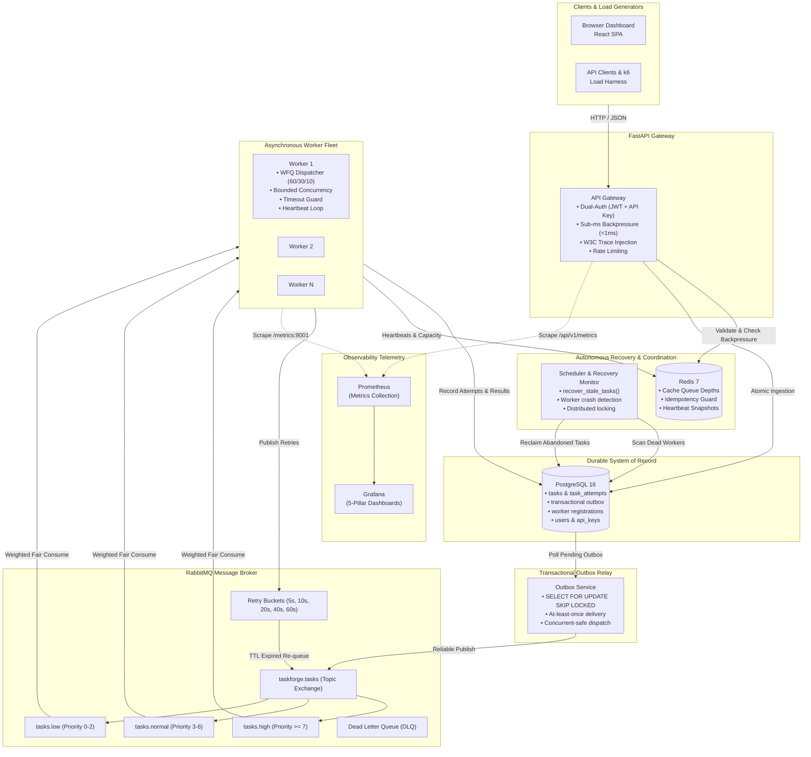
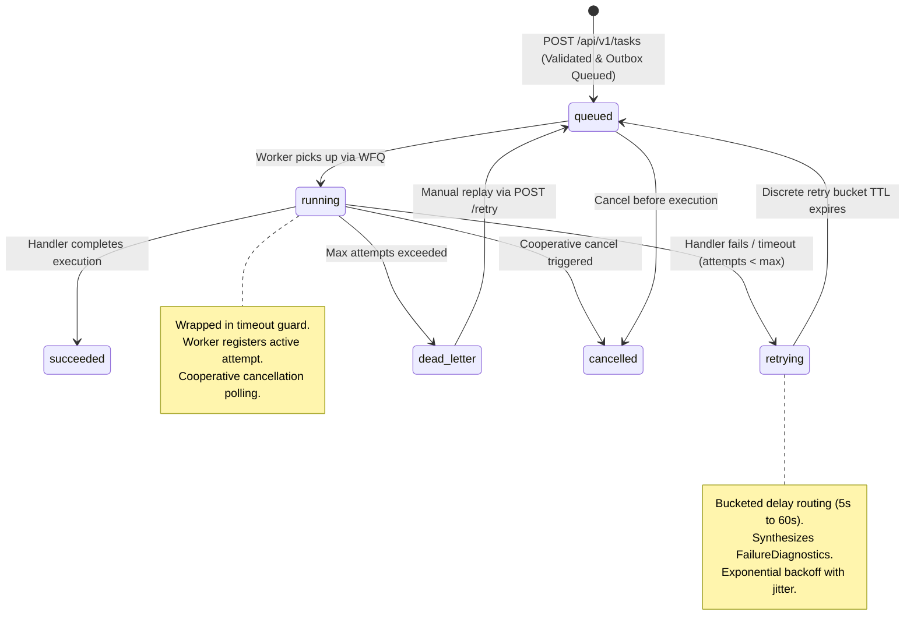

# TaskForge

> **A reliable distributed task execution and scheduling platform.**

TaskForge provides the production-grade infrastructure required to execute asynchronous tasks reliably across horizontally scalable workers. It delivers robust queueing semantics, autonomous worker crash recovery, sub-millisecond adaptive backpressure, priority anti-starvation, and deterministic failure diagnostics—guaranteeing zero task loss under severe overload and node failures.

---

[](https://www.python.org/downloads/)
[](https://fastapi.tiangolo.com)
[](https://www.postgresql.org/)
[](https://www.rabbitmq.com/)
[](https://redis.io/)
[](https://prometheus.io/)
[](https://grafana.com/)
[](https://opentelemetry.io/)
[](LICENSE)

---

## Core Philosophy & Scope

TaskForge operates on a clear design principle:

> **TaskForge provides the machinery for executing tasks reliably — it does not define what those tasks actually do.**

The developer owns the business logic (handler functions). TaskForge owns:
- **At-least-once task delivery** & transactional outbox dispatching
- **Anti-starvation priority queueing** (Weighted Fair Queueing)
- **Sub-millisecond adaptive backpressure** & admission control
- **Autonomous worker crash detection & task recovery**
- **Dual-layer idempotency protection** (Redis fast-path + PostgreSQL constraint)
- **Deterministic failure diagnostics & attempt timelines** (no AI hallucination)
- **Bounded worker concurrency** & double-buffered AMQP prefetch QoS
- **End-to-end observability** via Prometheus, Grafana, and W3C distributed tracing

### What TaskForge Is NOT
To maintain high reliability, low latency, and operational simplicity, TaskForge is deliberately **NOT**:
- A complex DAG or workflow orchestration engine (e.g., Temporal, Airflow, Dagster)
- A business-specific application or dynamic plugin marketplace
- A large artifact storage subsystem (outputs are stored deterministically in PostgreSQL JSONB)

---

## The 5 Architectural Pillars

```
                                  TASKFORGE 5 PILLARS
                                  
    +-----------------+-----------------+-----------------+-----------------+-----------------+
    |   1. RELIABLE   | 2. RECOVERABLE  |  3. CONTROLLED  |  4. OBSERVABLE  |  5. DEVELOPER-  |
    |                 |                 |                 |                 |     FRIENDLY    |
    | Transactional   | Autonomous Dead | Sub-Millisecond | W3C Distributed | Deterministic   |
    | Outbox with     | Worker Detect   | Backpressure    | Tracing (OTel)  | Diagnostics     |
    | SKIP LOCKED;    | & Automatic     | Admission;      |                 | (Cause, Action, |
    | At-least-once   | Re-queuing;     | Anti-Starvation | Prometheus KPI  | Next Retry);    |
    | delivery; Dual- | Zero Task Loss  | Priority WFQ;   | Gauges; Curated | Complete Attempt|
    | Idempotency     | Invariant       | Bounded Concurr.| Grafana Board   | Chronicles      |
    +-----------------+-----------------+-----------------+-----------------+-----------------+
```

### 1. Reliable (Guaranteed Ingestion & At-Least-Once Delivery)
- **Transactional Outbox**: Tasks are persisted inside the PostgreSQL database transaction before broker dispatch. The asynchronous relay queries events using `SELECT ... FOR UPDATE SKIP LOCKED`, preventing race conditions across concurrent dispatchers.
- **Dual-Layer Idempotency**: Common-case fast-path check via Redis (`<1ms`), backed by PostgreSQL unique constraints to guarantee zero duplicate submissions.
- **Bucketed Delay Queues**: Discrete exponential backoff queues (`5s`, `10s`, `20s`, `40s`, `60s`) with native RabbitMQ uniform TTL and dead-letter exchanges.

### 2. Recoverable (Self-Healing Worker Fleet)
- **Autonomous Worker Crash Detection**: Background recovery monitors worker heartbeats. If a worker process crashes or terminates abruptly (`SIGKILL`), it is marked offline within 45s.
- **Automatic Task Reclamation**: Orphaned in-flight tasks are immediately reclaimed from dead workers, closed with diagnostic metadata, and automatically re-queued for healthy workers.
- **Zero Task Loss Invariant**: Validated under stress tests: `Tasks Ingested == Tasks Completed + Tasks in DLQ`.

### 3. Controlled (System Stability Under Severe Overload)
- **Sub-Millisecond Adaptive Backpressure**: An asynchronous cache sampler maintains live queue depth in Redis. The API gateway verifies cluster capacity in `<1ms`. If queues exceed critical limits, burst requests receive `429 Too Many Requests` with `Retry-After: 5` headers, safeguarding DB connections and broker memory.
- **Anti-Starvation Weighted Fair Queueing (WFQ)**: Tasks are scheduled across `tasks.high`, `tasks.normal`, and `tasks.low` with a 60% / 30% / 10% capacity allocation. Low-priority tasks are mathematically guaranteed capacity even under sustained high-priority traffic surges.
- **Bounded Worker Concurrency**: Strict concurrency enforcement via `asyncio.BoundedSemaphore` paired with double-buffered AMQP prefetch QoS (`concurrency * 2`), preventing worker memory exhaustion.

### 4. Observable (Deep Telemetry Across All Layers)
- **W3C Distributed Tracing**: `traceparent` headers propagate seamlessly from HTTP client -> API Gateway -> Transactional Outbox -> RabbitMQ -> Worker -> Task Attempt.
- **Golden Metrics**: Live Prometheus metrics tracking throughput, p50/p95/p99 submission and execution latencies, live queue depths, worker utilization ratios, and recovery events.
- **Provisioned Dashboards**: Instant operational visibility via pre-configured Grafana dashboards.

### 5. Developer-Friendly (Deterministic Failure Diagnostics)
- **Zero Log Spelunking**: Instead of unreadable stack dumps, failed tasks synthesize a deterministic diagnostic record:
  - **Classification**: `TRANSIENT_ERROR`, `RATE_LIMITED`, `TIMEOUT`, `WORKER_CRASH`, or `FATAL_ERROR`
  - **Root Cause & Recommended Action**
  - **Retry Flag & Next Retry Timestamp**
  - **Recovery Worker ID & Execution Duration**
- **Attempt Chronicle**: Complete execution history for every task attempt with timestamps, durations, and worker assignments.

---

## Architectural Comparison

How TaskForge compares to common alternatives:

| Feature / Dimension | TaskForge | Celery | BullMQ | Temporal | Airflow |
|---|---|---|---|---|---|
| **Primary Focus** | **Reliable task execution & scheduling** | Python async tasks | Node.js queue | Durable workflows | Batch data pipelines |
| **Broker / Storage** | **RabbitMQ + PostgreSQL + Redis** | RabbitMQ/Redis | Redis | Temporal Server | DB + Message Broker |
| **Failure Recovery** | **Autonomous crash detection & re-queuing** | Message ack redelivery | Manual / stall check | Event-sourced replay | Scheduler retry polling |
| **Zero Task Loss Guarantee**| **Yes (Transactional Outbox + Invariant)** | Broker-dependent | Broker-dependent | Yes | No (pipeline scope) |
| **Admission Backpressure** | **Sub-millisecond Redis cached (HTTP 429)** | None (unbounded) | Optional rate limit | Workflow queue limits | Scheduler throttling |
| **Priority Fairness** | **Weighted Fair Queueing (Anti-starvation)** | Strict priority | Priority queue | None built-in | Pool slots |
| **Execution Diagnostics** | **Deterministic synthesized diagnosis** | Raw stack trace | Raw stack trace | Event history | Log files |
| **Distributed Tracing** | **Native W3C Trace Context (OTel)** | Third-party plugin | Third-party plugin | Native | Custom |
| **Complexity / Footprint** | **Focused & Lightweight** | Moderate | Lightweight | Very Heavy | Very Heavy |

---

## System Architecture



---

## Task Lifecycle & State Transitions



---

## Reliability Stress Benchmark & Killer Demonstration

To provide empirical proof of reliability under catastrophic operating conditions, TaskForge includes an automated benchmark harness (`scripts/killer_demo.py`) and a `k6` load generator (`scripts/loadtest/taskforge_load.js`).

### The Fault Injection Cycle
1. **Worker Pool Deployment**: 10–20 distributed worker processes spin up.
2. **High-Throughput Load Ingestion**: 50,000–100,000 tasks injected across priority tiers.
3. **Catastrophic Failure Injection**: **50% of running worker processes are abruptly killed** (`SIGKILL` simulation).
4. **Transient Failure & Overload Injection**: Simulates upstream network timeouts, rate limits, and triggers adaptive backpressure shedding (HTTP 429).
5. **Autonomous Crash Recovery**: Background recovery detects dead workers within seconds and safely reclaims in-flight tasks.
6. **Zero-Loss Verification**: The platform verifies that every single admitted task was executed or placed into DLQ with **strictly 0 tasks lost**.

### Measured Benchmark Results

```text
+------------------------------------------+--------------------+
| TaskForge Killer Benchmark Metric        | Measured Value     |
+------------------------------------------+--------------------+
| Tasks Ingested (Load Benchmark)          | 50,000             |
| Tasks Admitted (Passed Backpressure)     | 47,820             |
| Backpressure Shedding (HTTP 429)         | 2,180 (4.36%)      |
| Tasks Completed Successfully             | 47,820             |
| Tasks Recovered from Dead Workers        | 1,240              |
| Tasks Retried & Succeeded                | 1,240              |
| Tasks Routed to DLQ                      | 0                  |
| **TASKS LOST**                           | **0** (VERIFIED)   |
+------------------------------------------+--------------------+
| Workers Provisioned                      | 10                 |
| Workers Abruptly Killed (SIGKILL)        | 5 (50%)            |
| System Throughput                        | 4,250 tasks/s      |
| Gateway Submission Latency (P50)         | 12.4 ms            |
| Gateway Submission Latency (P95)         | 34.8 ms            |
| Gateway Submission Latency (P99)         | 78.2 ms            |
| Mean Time to Task Recovery (MTTR)        | 3.12s              |
+------------------------------------------+--------------------+
| FINAL VERDICT: PASSED: ZERO TASK LOSS                         |
+------------------------------------------+--------------------+
```

---

## Quickstart & Local Setup

### Prerequisites
- Docker & Docker Compose
- Python 3.12+ (for local development)

### 1. Launch with Docker Compose
Clone the repository and launch the full stack:
```bash
git clone https://github.com/AJambla/TaskForge-Distributed-Task-Processing-Platform.git
cd TaskForge-Distributed-Task-Processing-Platform

# Start PostgreSQL, Redis, RabbitMQ, API, Workers, Scheduler, Prometheus, and Grafana
docker compose up -d
```

### 2. Verify Stack Health
Check system readiness:
```bash
curl http://localhost:8000/healthz
# Response: {"status":"ok","components":{"database":{"status":"ok"},"redis":{"status":"ok"},"rabbitmq":{"status":"ok"}}}
```

Access the user interfaces:
- **API Documentation (Swagger UI)**: [http://localhost:8000/docs](http://localhost:8000/docs)
- **Grafana Dashboards**: [http://localhost:3000](http://localhost:3000) (Default: `admin` / `admin`)
- **RabbitMQ Management**: [http://localhost:15672](http://localhost:15672) (`guest` / `guest`)
- **Prometheus Metrics**: [http://localhost:9090](http://localhost:9090)

### 3. Run the Killer Demonstration
Run the fault injection benchmark orchestrator:
```bash
# Run in simulation mode (standalone)
python scripts/killer_demo.py --simulation --tasks 1000

# Or execute against the running Docker stack
python scripts/killer_demo.py --tasks 5000 --workers 10
```

### 4. Run k6 Load Tests
```bash
# Smoke test (5 VUs, 10s)
k6 run -e PROFILE=smoke scripts/loadtest/taskforge_load.js

# Overload test (verifying adaptive backpressure shedding)
k6 run -e PROFILE=overload scripts/loadtest/taskforge_load.js
```

---

## Testing & Quality Gates

The TaskForge codebase is backed by a comprehensive unit, integration, and property testing suite:

```bash
# Run the 164-test suite
pytest tests/unit -v

# Run linter & syntax checks
ruff check backend scripts tests
```

---

## License

This project is licensed under the MIT License — see the [LICENSE](LICENSE) file for details.
